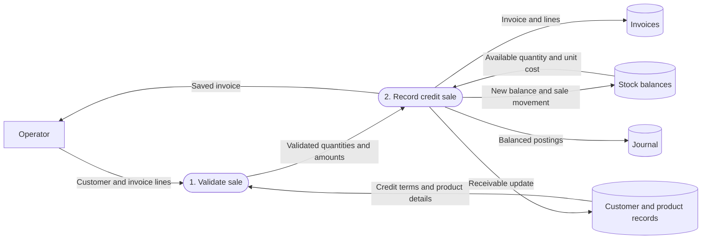
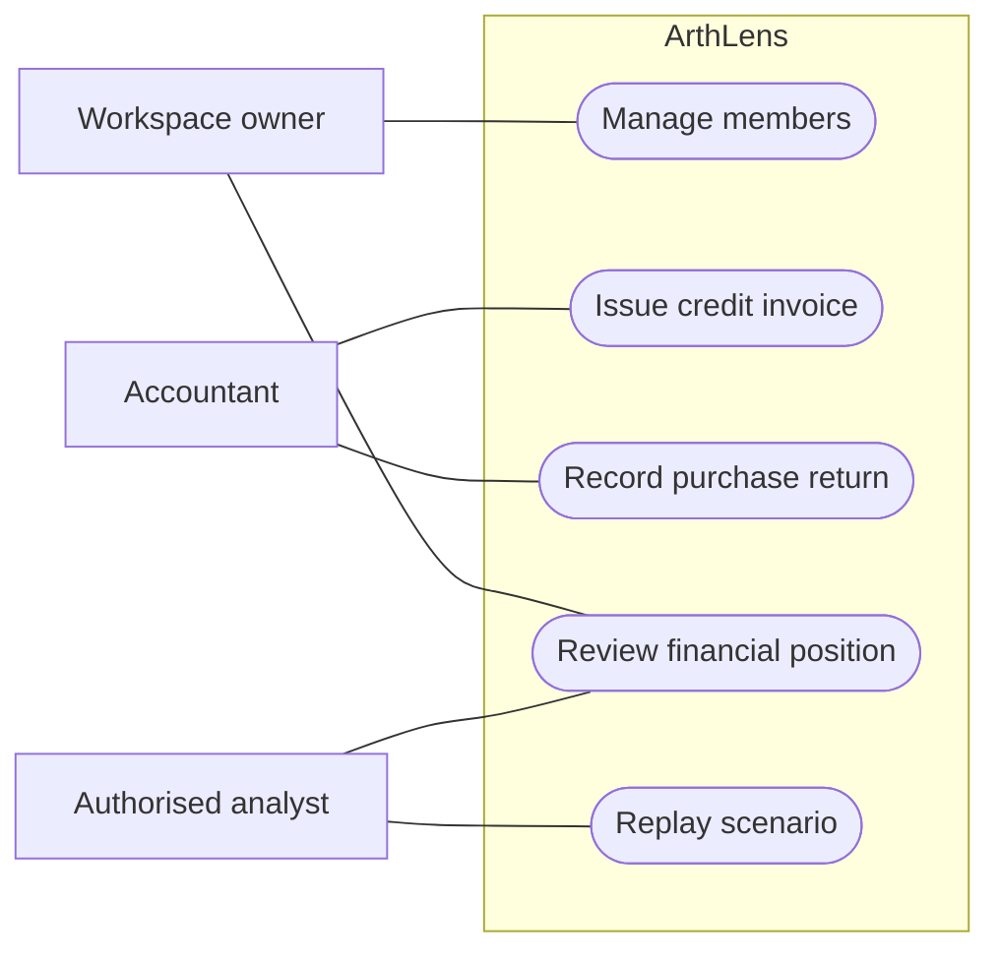
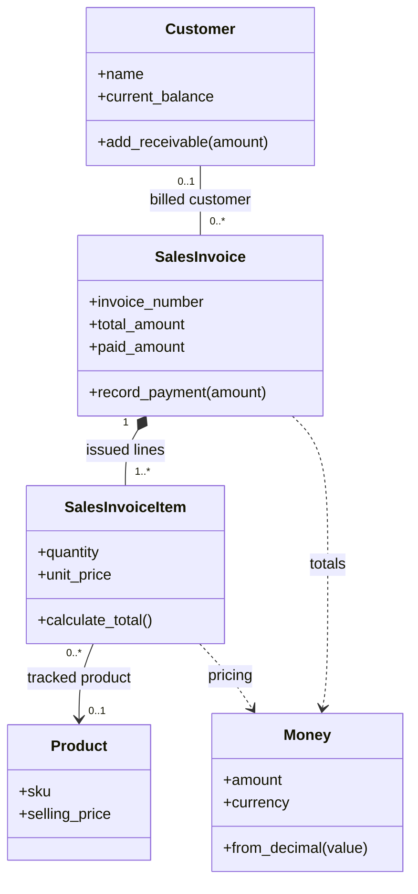
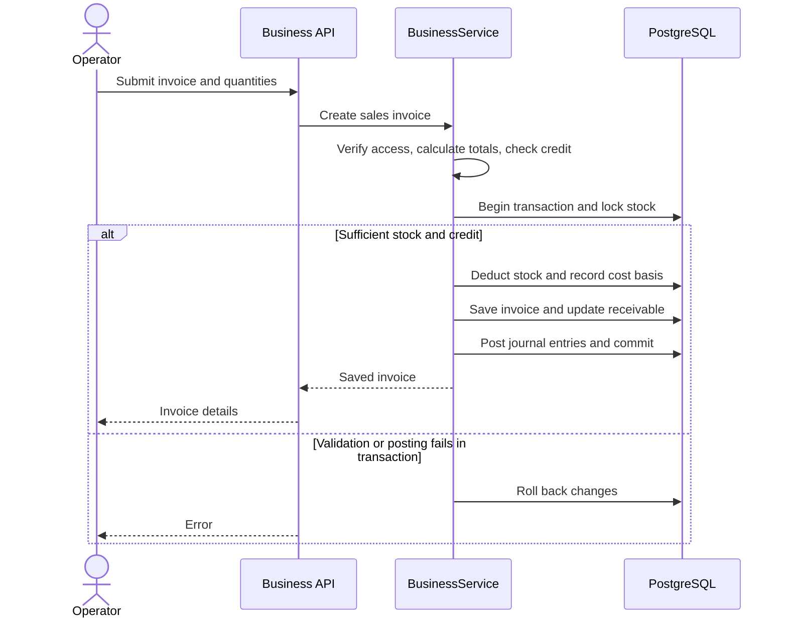
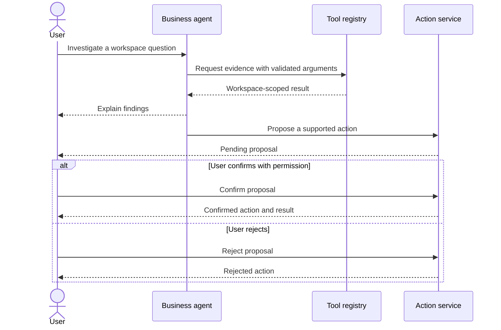
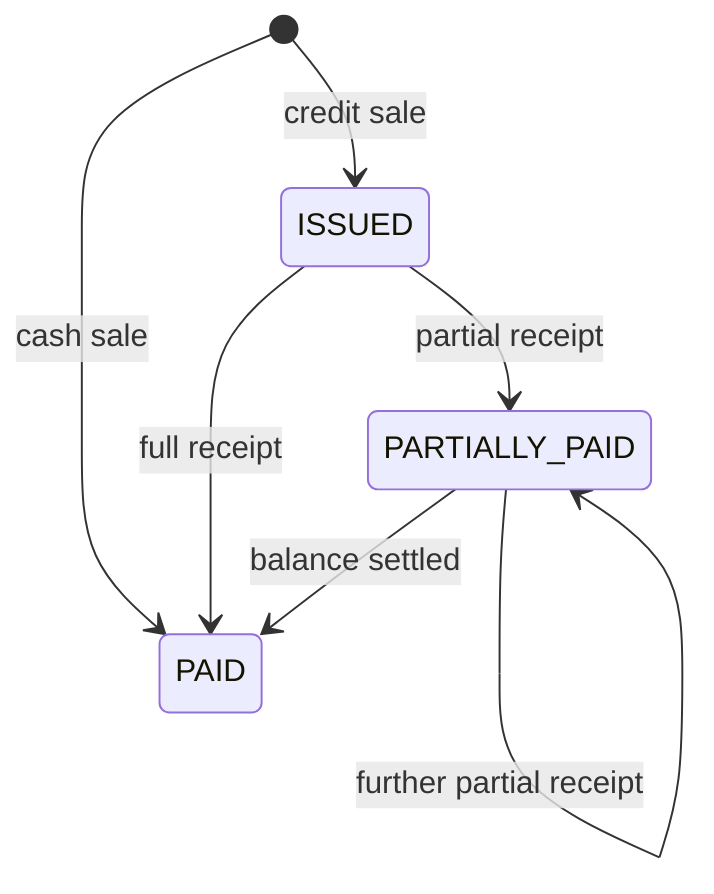
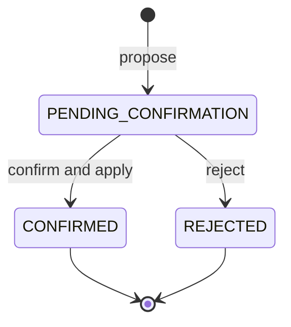

# अर्थLens (ArthLens) — Software Engineering Project

ArthLens is a web application for small businesses that connects purchases, inventory, invoices, customer and supplier ledgers (*Khata*), financial analysis and decisions within a workspace. A sale is a useful way to understand the engineering problem: the invoice, stock movement, receivable and journal entries must agree, including when the sale fails halfway through.

**Course project · Software Engineering · IIIT Allahabad**

[Frontend](https://arthlens-two.vercel.app) · [Backend](https://arthlens-n6ah.onrender.com) · [User guide](docs/USER_GUIDE.md) · [Evaluation walkthrough](#11-evaluation-walkthrough-and-team)

## Reading guide

| Course unit | Project material |
|---|---|
| 1 · Software characteristics, components, principles, measurement and process models | [Problem and scope](#1-problem-and-scope), [lifecycle](#2-development-lifecycle), [measurement and control](#7-planning-estimation-and-control) |
| 2 · Requirements, structured analysis, design, architecture and UML | [Requirements](#3-requirements-and-acceptance), [architecture and data flow](#4-architecture-and-structured-design), [object-oriented principles](#5-object-oriented-design), [UML models](#6-uml-models) |
| 3 · Planning, scheduling, size and cost, risks, reliability, quality and client/server development | [Client and server](#4-architecture-and-structured-design), [planning and estimates](#7-planning-estimation-and-control), [risk and quality](#8-risk-reliability-and-quality-assurance) |
| 4 · Verification, validation, inspection, testing, debugging, maintenance and configuration management | [Test plan and results](#9-verification-validation-and-test-plan), [release and maintenance](#10-local-launch-release-and-maintenance) |

## 1. Problem and scope

A shop can record a credit sale in its billing system and still omit the amount from the customer's Khata. A second operator can sell the same remaining stock before the first operator finishes. A report built from either partial record can overstate cash or margin. ArthLens treats these as requirements for consistency, concurrency control and traceability.

| User task | Workspace modules | Observable result |
|---|---|---|
| Record what was bought, sold or returned | Suppliers, purchases, inventory, sales, customers, Khata | Stock, party balances and the general ledger reflect the commercial event. |
| Understand the business | Finance, analytics, reports, constellation | The operator can inspect financial results and export evidence. |
| Evaluate a change | Decisions, scenarios, goals | The workspace can retain a decision version, replay a seeded scenario and check progress against a goal. |
| Control who can act | Workspace overview, members, settings, audit, agent | Requests are scoped to the workspace. Proposed agent actions can be reviewed before execution. |

**System boundary.** The assessed prototype covers the path from a business transaction to a report or a reviewed decision. It relies on a browser, a server and a relational database. Identity, email and model providers are external integrations. Statutory filing, actual bank settlement and an independently audited financial statement are outside this demonstration. The [workspace pages](frontend/app/workspaces/%5Bid%5D), [product requirements](docs/PRODUCT_REQUIREMENTS.md) and [API specification](docs/API_SPECIFICATION.md) provide the detailed inventory.

## 2. Development lifecycle

**Software characteristics and applications.** A second installation can run the same code, yet its behaviour depends on its schema revision, configuration, stored records and external services. Maintenance therefore includes migrating data and reproducing the running environment. The transactional application (sales and Khata) requires consistency, the analytical application (financial statements and scenarios) requires reproducible inputs, and the interactive application (agent and workspace UI) requires clear feedback and permission boundaries. These different quality needs explain the module boundaries.

**Model selected: iterative and incremental development.** Domain and persistence are prerequisites for recording sales. Sales and purchase history supply the inputs for financial analysis. Versioned analyses, in turn, provide evidence for agent investigations. These dependencies give each increment a useful output and a clear acceptance test. Existing increments can be revisited when a new requirement exposes a weakness. For example, historical inventory movements with missing cost evidence need reconciliation before some reversals can be valued reliably.

| Increment | Requirement and design work | Deliverable and exit check |
|---|---|---|
| 1 · Foundation | Define workspace ownership, roles, monetary precision and tenancy boundaries. Model entities and keys. | A member can access their workspace, while a request for another workspace is refused. Check the role matrix. |
| 2 · Commerce | Trace a credit sale, a purchase and a return. Identify which writes must succeed together. | Post a sale, then try a multi-line sale with insufficient stock on the last line. Check both the success and rollback paths. |
| 3 · Financial intelligence | Agree how to value stock and calculate receivables. Identify where historical cost is missing. | Reconcile a supported historical movement and trace its effect on the financial view. |
| 4 · Decisions and governance | Version assumptions, capture simulation seeds and define the approval boundary. | Replay a scenario. Propose a goal, inspect the pending action, confirm once and check the resulting goal. |
| 5 · Release and feedback | Integrate the browser, API and database. Review migration compatibility and the operating guide. | Exercise the complete workflow, export a report, record defects and feed them into the next increment. |

Within each increment the cycle is **elicit → specify acceptance criteria → model → implement → verify → demonstrate → revise**. This is a retrospective interpretation of the [project plan](docs/PROJECT_PLAN.md), [implementation log](docs/IMPLEMENTATION_LOG.md) and migration sequence. The repository does not establish formal Scrum ceremonies or a measured sprint velocity.

| Syllabus process model | Where it fits this project |
|---|---|
| Waterfall | An agreed role matrix or database migration benefits from specification and review before implementation. Freezing the entire product up front would make discoveries such as missing historical cost expensive to address. |
| Prototyping | A seeded workspace lets a reviewer try a purchase or read a goal deviation before settling the interface and terminology. Feedback should become a testable requirement. |
| Incremental and iterative enhancement | Adding scenario replay is an increment. Revisiting an existing cost workflow to recover provenance is iterative enhancement. Both depend on regression tests. |
| Spiral | Use a risk-driven loop for a change such as concurrent returns: identify over-return risk, prototype a locking rule, exercise two sessions, then decide whether to release. |
| Agile and contemporary practice | Small demonstrable changes, version control, automated checks and deployment preflight shorten the feedback loop. CI provides rapid integration feedback. An AI feature still needs explicit inputs, acceptance tests and human review. |

## 3. Requirements and acceptance

**Stakeholders.** The owner needs a trustworthy view of cash and stock. The accountant needs balanced postings and traceable corrections. The manager needs operational access. An analyst or viewer needs authorised read access. The maintainer needs a reproducible schema, configuration and diagnosis procedure. The [business role definitions](backend/arthlens/domain/business.py) and [role contract tests](backend/tests/contract/test_rbac_matrix.py) specify where these responsibilities differ.

**Elicitation and analysis.** The [SRS](docs/SRS.md) and [use-case traceability](docs/USE_CASE_TRACEABILITY.md) are available evidence. Three techniques suit further elicitation: walk through an invoice and its ledger entries with an accountant, observe a clerk handling a partial return, and ask an owner to review a prototype showing overdue balances. Record the actor, preconditions, normal path, exceptions and acceptance criterion. These are proposed stakeholder sessions, with no interview outcomes assumed here.

| Requirement | Constraint or exception | Acceptance evidence |
|---|---|---|
| Record a credit invoice and its financial effects together. | Caller has a permitted role, products belong to the business, credit and stock checks pass. | Insufficient stock on a later line undoes earlier deductions. [Transaction tests](backend/tests/integration/test_business_transaction_integrity.py) |
| Return purchased stock against its source. | The same request cannot refund the same quantity twice. Source value and tax determine the return. | Check partial, repeated and concurrent returns against the original purchase. [Transaction tests](backend/tests/integration/test_business_transaction_integrity.py) |
| Preserve financial assumptions for repeat review. | A replay uses stored scenario-version inputs and random seed. | Compare the replayed run with its originating version. [Scenario service](backend/arthlens/services/scenario_service.py) · [Decision API tests](backend/tests/integration/test_decision_api.py) |
| Explicitly approve an agent-proposed change. | The pending proposal belongs to a workspace and session. An already resolved action cannot be confirmed again. | Proposing a goal creates a pending action. Confirmation creates the goal and records its resource ID. [API test](backend/tests/integration/test_agent_and_reports_api.py) |
| Control access throughout the lifecycle. | A valid identity alone does not establish authority over a different business. | Exercise allowed and forbidden role/operation combinations. [RBAC contract](backend/tests/contract/test_rbac_matrix.py) |

**Non-functional requirements.** Financial operations must preserve exact two-decimal results at the domain boundary. Failed transactions must leave no partial writes. Workspace isolation must cover both data retrieval and mutation. Important workflows must be repeatable on an isolated test database. Usability and response-time objectives require explicit task definitions, load and measurements. The [requirements matrix](docs/REQUIREMENTS_TRACEABILITY.md) provides broader coverage. Use the tests and implementation to resolve differences between early design documents and the prototype.

## 4. Architecture and structured design

ArthLens uses a client/server architecture. Next.js presents the workspace and sends HTTP requests. FastAPI authenticates the caller, validates the request and invokes application services. Services coordinate domain rules and repositories. PostgreSQL persists changes, with Alembic maintaining the schema. Financial and decision modules compute results used by reports and the agent. The browser presents outcomes while the server enforces access and correctness.

| Component | Responsibility | Boundary and design decision |
|---|---|---|
| [Web client](frontend/app) and [API](backend/arthlens/api) | Navigation, forms, HTTP validation, authorisation and response formatting | A client can preview a value. The server recalculates or validates values it will persist. |
| [Domain](backend/arthlens/domain) | Money, invoice items, inventory balances, journal entries and their rules | A domain object can be tested without starting a web server. |
| [Application services](backend/arthlens/services) and [infrastructure](backend/arthlens/infra) | Coordinate workflows and persist state | Multiple repositories can share one transaction. Splitting inventory, billing and posting into independently committed writes would risk partial sales. |
| [Finance](backend/arthlens/finance), [decisions](backend/arthlens/decision) and [reporting](backend/arthlens/reporting) | Compute indicators, compare alternatives, render evidence | Stored inputs and computed results can be inspected independently of how a screen or PDF presents them. |
| [Agent](backend/arthlens/agent) and [action service](backend/arthlens/services/agent_action_service.py) | Investigate with tools and stage permitted actions | The model can propose an action. The service checks its payload and state before applying it. |

**Structured analysis (SA).** At context level, the operator supplies transaction details and receives an invoice or rejection. At the next level, the data-flow diagram below follows the information for a credit sale. Arrows describe data movement, while the sequence diagram in section 6 shows call order.



**Structured design (SD).** Convert the central transformation above into a *structure chart*. The top-level control module is invoice creation. Its subordinate responsibilities are validate input, calculate totals, update stock, save the invoice, update receivables and post the journal. This is a functional decomposition of [the service](backend/arthlens/services/business_service.py), not a claim that each responsibility is a separate Python function.

```text
create_sales_invoice
├── check role, workspace, products and customer credit
├── build invoice lines and calculate totals
└── execute one transaction
    ├── deduct tracked stock and record its cost
    ├── persist invoice and items
    ├── update customer receivable
    └── post balanced journal entries
```

Top-down design starts with the operator's goal and partitions the work as above. Bottom-up design starts with reusable, independently testable operations such as amount rounding and journal balance validation. Functional design explains how data is transformed. Object-oriented design explains which object owns each value or rule. Cohesion improves when scenario-version logic stays together in its service. Coupling remains important where the commerce service coordinates several repositories. A shared transaction and integration tests make that dependency explicit. See the [architecture](docs/ARCHITECTURE.md), [database design](docs/DATABASE_DESIGN.md) and [decision records](docs/DECISIONS.md).

## 5. Object-oriented design

### Financial rules as design specifications

| Rule | Worked example or acceptance condition | Owner in the implementation |
|---|---|---|
| Monetary precision | In INR, constructing `Money` from the decimal string `"12.345"` gives ₹12.35 using half-up rounding. Adding amounts in different currencies raises an error. | [Money](backend/arthlens/domain/business.py) |
| Stock valuation | Ten units costing ₹60 each plus ten at ₹80 give 20 units valued at ₹1,400. The weighted-average unit cost is ₹70. A subsequent sale of two tracked units captures ₹140 of cost. | [InventoryBalance](backend/arthlens/domain/business.py) and [sales posting](backend/arthlens/services/business_service.py) |
| Journal balance | A ₹200 credit sale with zero tax debits receivables and credits revenue by ₹200. A separate posting debits cost of goods sold and credits inventory at the sale-time cost. Each journal entry must balance on its own. | [JournalEntry](backend/arthlens/domain/business.py) |
| Scenario reproducibility | Store the version, baseline snapshot, distribution assumptions, iteration count and seed with the run. Replaying those inputs provides a comparison against the recorded result. | [ScenarioService](backend/arthlens/services/scenario_service.py) |

### Object-oriented principles in the implementation

| Principle | Concrete example | Why it matters |
|---|---|---|
| Classes, instances and construction | Each `SalesInvoiceItem` instance has its own quantity, price and discount. `Money.__post_init__` normalises an amount to two decimal places. | Construction establishes the monetary representation used by subsequent calculations. |
| Encapsulation | `SalesInvoice.record_payment()` updates the paid amount and payment status. `InventoryBalance.apply_deduction()` checks the quantity. | Callers can reuse a rule through a named operation. Persistence and access checks still belong to the service. |
| Abstraction | `UserRepository` defines a persistence contract. `ILLMClient` defines the model-client boundary. | Callers can depend on the operation without knowing the storage or provider details. |
| Inheritance | `PostgresUserRepository` implements `UserRepository`. `UserAlreadyExistsError` specialises `RepositoryError`. | Implementations share a contract and callers can handle a family of failures. |
| Polymorphism | Gemini, deterministic and replay clients implement the model-client interface. | The same caller can use a live provider for a demonstration and a repeatable client for tests. |

Composition appears in the invoice and its line items. Association appears in the optional invoice-to-customer link. A workspace groups users through membership records. A user has an identity independent of any one membership, an example of aggregation at the domain level. [Domain entities](backend/arthlens/domain/business.py) · [Repository contracts](backend/arthlens/domain/repositories.py) · [Provider implementations](backend/arthlens/llm/provider.py)

## 6. UML models

### Use cases and actors



This is an actor/use-case view. The role matrix defines the precise API permissions for each operation.

### Class diagram — sales model



### Sequence — issuing a credit sale



### Sequence — investigating and confirming an action



### Activity — handling a historical cost gap


### State models — invoice and agent proposal



This invoice view isolates issuance and settlement. The domain also defines draft, overdue and cancelled statuses. The separate action lifecycle below follows the actual persisted statuses. Confirmation holds a row lock while applying the action and recording its result.



## 7. Planning, estimation and control

The following is a **proposed six-week baseline for a three-person course team**. Weeks are relative to kickoff. The [historical project plan](docs/PROJECT_PLAN.md) describes dependency order separately. These estimates and work packages are not a timesheet or a record of individual contributions.

| Week | Work package and dependency | Reviewable milestone |
|---|---|---|
| 1 | Define users, scope, constraints and acceptance examples with the team. | Reviewed SRS and use cases, including a rejected sale. |
| 2 | Model domain entities and API contracts. Establish authenticated workspace and database baseline. | Class diagram, schema migration and role checks. |
| 3 | Implement purchases, credit sales, returns and journal posting on that foundation. | Demonstrate a correct posting and a complete rollback. |
| 4 | Build financial analysis, scenario replay and goals from operational records. | Reproduce one calculation and one seeded result. |
| 5 | Integrate the agent, approvals and reports. Exercise browser and API paths. | Show that proposal alone creates no goal. Export and inspect a report. |
| 6 | Run regression tests, review accessibility, rehearse a clean deployment and triage outstanding defects. | Test record, risks, maintenance plan and evaluation demo. |

A practical division is one workstream for requirements and domain flows, one for application and data services, and one for interface and system testing. Rotate review between workstreams. At each checkpoint, compare accepted use cases with planned use cases, record unresolved defects by severity and move dependent tasks when a prerequisite fails. A feature is complete when the model, code, test and user-facing behaviour agree.

### Size and effort measurement

These are measured examples at source revision `2891aaf`. The scope is deliberately small so a reviewer can repeat the count.

| Python source file | Physical LOC | Lexical tokens | Function definitions |
|---|---:|---:|---:|
| [Domain entities](backend/arthlens/domain/business.py) | 777 | 4,113 | 45 |
| [Scenario service](backend/arthlens/services/scenario_service.py) | 234 | 2,002 | 14 |
| [Action service](backend/arthlens/services/agent_action_service.py) | 258 | 2,112 | 9 |

LOC includes blank lines and comments. Token count uses Python's tokenizer, excluding comments, encoding, indentation, newline and end markers. Function count includes synchronous and asynchronous definitions, methods and nested functions from the Python syntax tree. These measures describe size, not quality or productivity. A function-point estimate would separately count user-visible inputs (invoice submission), outputs (report), queries (Khata lookup), logical files (invoices) and external interfaces. Function definitions are not function points.

**COCOMO classroom estimate.** The three measured files total 1.269 physical KLOC. Using this as a rough size proxy in Basic COCOMO's organic mode gives effort ≈ `2.4 × 1.269^1.05 = 3.08 person-months` and duration ≈ `2.5 × 3.08^0.38 = 3.83 months`. A money estimate would multiply effort by a stated cost per person-month. Physical LOC includes non-executable lines, and the sample excludes the frontend, database and integration work. The result illustrates the model, not observed team effort or a forecast for the six-week plan. For scheduling, estimate work packages, account for dependencies and revise after each milestone.

## 8. Risk, reliability and quality assurance

| Risk | Design or control | Evidence or next measurement |
|---|---|---|
| A partial sale leaves stock and ledgers inconsistent | Shared transaction, balance validation and rollback | Exercise a shortage on the second line and compare pre/post balances. |
| Concurrent returns exceed the purchased quantity | Validate source quantity under transactional controls | Run the concurrent returns case in the [integrity suite](backend/tests/integration/test_business_transaction_integrity.py). |
| A valid user reads another workspace | Scope queries and check permissions at the service/API boundary | [Tenant tests](backend/tests/integration/test_agent_tenant_security.py) and [role matrix](backend/tests/contract/test_rbac_matrix.py). |
| Missing cost distorts gross margin | Preserve movement cost evidence and reconciliation history | Inspect an unresolved movement and its reviewed adjustment. [Cost service](backend/arthlens/services/inventory_cost_service.py) |
| Provider output changes between runs | Exercise deterministic paths and inspect provenance before accepting tool inputs | [Agent evaluations](backend/tests/agent_eval/test_agent_investigation_eval.py). Evaluate live-provider behaviour separately. |
| A schema change breaks an existing installation | Version migrations and exercise upgrades on a disposable database | [Migration tests](backend/tests/integration/test_migrations.py). Rehearse restore on a separate copy before release. |

**Quality attributes.** Reliability concerns whether a completed operation meets its contract over repeated use. Security adds identity, authorisation and tenant isolation. Maintainability depends on clear ownership of rules, migration history and regression tests. For usability, ask a first-time operator to enter a credit sale and find the resulting due balance without help. For performance, measure p95 invoice latency and failure rate under a stated concurrency level, database size and hardware configuration. The latter two are proposed evaluations.

**Reliability metrics and models.** Track failed valid requests / total valid requests, time between service failures and mean time to restore. Keep rejected invalid inputs separate from service failures. Availability can be estimated from uptime / observation time. A reliability-growth model such as Musa–Okumoto could fit cumulative failures against execution time during repeated release testing. It requires a consistent workload and failure log. The suite pass count alone supplies neither an uptime figure nor a fitted model.

**Process quality.** The ISO 9000 family provides a framework for quality management. In this project, traceability, review records and corrective actions are examples of evidence one could inspect against a quality process. ISO 9001 certification would require an external assessment. The SEI Capability Maturity Model distinguishes initial, repeatable, defined, managed and optimising processes. Versioned tests show repeatable work. A defined release procedure, trend measurements and documented improvements would support assessment of later stages. No certification or maturity rating is claimed. [Risk register](docs/RISK_REGISTER.md) · [Test strategy](docs/TEST_STRATEGY.md)

## 9. Verification, validation and test plan

**Verification** asks whether the implementation satisfies a specification. **Validation** asks whether the resulting workflow solves the operator's problem. Checking that a journal balances verifies an invariant. Asking an accountant to trace an unpaid invoice to the correct Khata entry validates the workflow.

| Test case and level | Setup and input | Expected observation and evidence |
|---|---|---|
| Unit · monetary arithmetic | Generate amounts, construct value objects and compose additions, subtractions or integer multiplications. | Values stay quantised to two decimals and satisfy the tested arithmetic properties. [Property tests](backend/tests/unit/test_money_property_invariants.py) |
| Contract · workspace roles | Repeat the same operation as an allowed and a restricted role. | The permission decision matches the role/operation matrix. [Contract tests](backend/tests/contract/test_rbac_matrix.py) |
| Integration · atomic sale | Seed stock for the first invoice line and insufficient stock for a later line. | Invoice creation fails and earlier stock deductions are rolled back. [Transaction tests](backend/tests/integration/test_business_transaction_integrity.py) |
| Integration · schema evolution | Start at a supported predecessor and upgrade an isolated database. | The expected revision, columns and tables exist. [Migration tests](backend/tests/integration/test_migrations.py) |
| System · business lifecycle | Create a workspace, record commercial events, analyse finances and export. | Outputs remain linked across the complete journey. [Lifecycle test](backend/tests/e2e/test_full_platform_lifecycle.py) |
| Browser and agent validation | Exercise authentication and operations in a browser. Separately supply an incomplete request to the agent. | Browser journeys reach user-visible results. The agent asks for missing data or retains a proposal pending confirmation. [Playwright](frontend/e2e) · [Agent eval](backend/tests/agent_eval/test_agent_investigation_eval.py) |

**Testing strategies.** Bottom-up integration starts with money, inventory and journal rules, then adds repositories and a real database. Top-down integration starts from a user or HTTP request and substitutes a controlled provider. The browser journey joins the layers. Functional testing asserts visible outcomes such as the exported report. Structural testing selects branches such as cash versus credit or the exception path after a stock deduction. Branch coverage would need an instrumented run and a stated denominator.

**Inspection and debugging.** In a code review of a purchase return, trace the original purchase line, quantity limit, transaction boundary and journal posting. For a reported mismatch, capture a minimal fixture, reproduce it against the same schema, inspect stock movements and journal lines, isolate the first inconsistent write, fix the responsible layer and retain the fixture as a regression test. An internal seeded walkthrough is a suitable alpha exercise. A beta would ask representative operators to use a trial workspace and record task failures before release. Formal alpha/beta results are not documented here.

**Recorded results.** The [test report dated 12 November 2026](docs/TEST_PLAN_AND_RESULTS.md) records **291 backend tests**, **23 Vitest tests**, **5 Playwright tests** and **7 smoke checks** passing in the recorded local configurations. The backend result used the deterministic provider. The report records different results under Gemini. These figures identify the historical baseline and should be updated with the revision and environment after a fresh run.

## 10. Local launch, release and maintenance

Use Python and Node versions aligned with [CI](.github/workflows/ci.yml) (Python 3.14 and Node 20 in that configuration). Provide PostgreSQL/PostGIS through Docker or the supported local Windows installation. Configure development values from the [root environment example](.env.example) and [frontend example](frontend/.env.example). Keep real credentials out of version control.

From the repository root on Windows, install dependencies once and start the application:

```powershell
python -m venv .venv
.\.venv\Scripts\python.exe -m pip install -e "./backend[dev]"
npm ci --prefix frontend
.\run-local.ps1 -Wait
```

Open the client at `http://localhost:3000`. The [launcher](run-local.ps1) checks the database, applies migrations, seeds local demo accounts and starts the services. Stop them from another terminal with `.\stop-local.ps1`. The [deployment environment example](deployment/env.example) and [preflight script](scripts/deployment_preflight.py) describe the release configuration.

For local verification, configure a **dedicated test database** using the [backend test configuration](backend/tests/conftest.py). In the repository virtual environment, run:

```powershell
$env:LLM_PROVIDER = "deterministic"
.\.venv\Scripts\python.exe -m pytest backend/tests -v
```

From `frontend/`, run `npm test -- --run` and `npm run build`. For Playwright, install Chromium with `npx playwright install chromium` and follow the [browser test configuration](frontend/playwright.config.ts). Record the commit, provider, migration head, environment and failures alongside the result.

On Linux or macOS with Docker Compose available, the repository provides [start.sh](start.sh) and [stop.sh](stop.sh). From the project root use `bash start.sh` to launch the stack and `bash stop.sh` to stop it. The [smoke checks](deployment/smoke/run_smoke_checks.py) exercise a running deployment. Review their environment and account settings before running them against a disposable workspace.

| Maintenance category | ArthLens example | Change and release control |
|---|---|---|
| Corrective | A partial return allocates the wrong tax amount. | Reproduce with a minimal purchase, fix the allocation, rerun return and ledger tests. |
| Adaptive | Identity-provider configuration or the database platform changes. | Update configuration and preflight together, then test login or upgrade against a representative environment. |
| Perfective | Operators need a more informative goal deviation report. | Agree on the expected output, extend the goal service, update the report and test the full workflow. |
| Preventive | Older stock movements lack cost provenance. | Detect incomplete records, retain evidence for reconciliation and test historical replay. |

**Maintenance model and reuse.** A quick fix may restore a screen while leaving its report inconsistent. Prefer iterative enhancement with impact analysis, a regression test, a reviewed migration where necessary, and an updated handover. Reuse the money and journal rules across commercial operations. Reuse scenario snapshots for repeatable analysis. Reverse engineering here means tracing an existing route through service calls, database relationships and tests to recover its actual design. Re-engineering uses that recovered model to change the system safely, as in adding reconciliation records for legacy movements. [Maintenance plan](docs/MAINTENANCE_PLAN.md) · [Engineering handover](docs/ENGINEERING_HANDOVER.md)

**Configuration management.** Git revisions identify source baselines, the npm lockfile pins frontend dependency resolution, and [Alembic revisions](backend/migrations/versions) order database changes. Review a change as one configuration item across code, schema, API contract, tests and documentation. Before deployment, check environment configuration and schema compatibility. After deployment, verify readiness and one end-to-end operation. For recovery, identify the compatible application version and rehearse database restoration on a copy before relying on the procedure.

## 11. Evaluation walkthrough and team

1. **Show the requirement.** Open a seeded workspace and select an inventory-tracked product. Note its starting quantity, unit cost and the customer's opening balance.
2. **Follow a credit sale.** With ten units at a unit cost of ₹60, sell two at ₹100 each with zero tax and discount. Expect eight units left, ₹200 added to receivables, ₹120 cost of goods sold and ₹80 gross profit on the sale. The revenue entry and cost entry must each balance. Stock additions use weighted-average cost, and the sale captures the unit cost at movement time.
3. **Test a failure.** Request more units than remain. Check that the invoice, stock and journal history did not change. Relate this check to the sequence diagram and the rollback integration test.
4. **Show reproducibility and approval.** Run and replay a seeded scenario. Propose a goal through the agent, inspect its pending state, confirm it and open the resulting resource.
5. **Close the trace.** Export a report and show the requirement, code path and test that support one reported figure. Use the [demo guide](docs/DEMO_GUIDE.md) for additional journeys.

| Team member | Roll number |
|---|---|
| Abhay Pratap Singh | IIT2025109 |
| Ayush Mishra | IIT2025108 |
| Mayank Puri | IIT2025104 |
