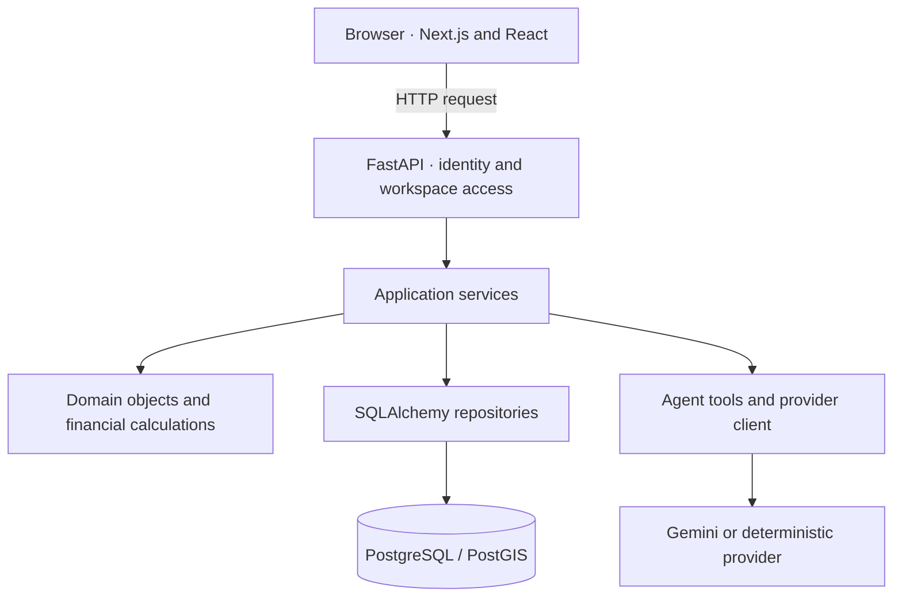
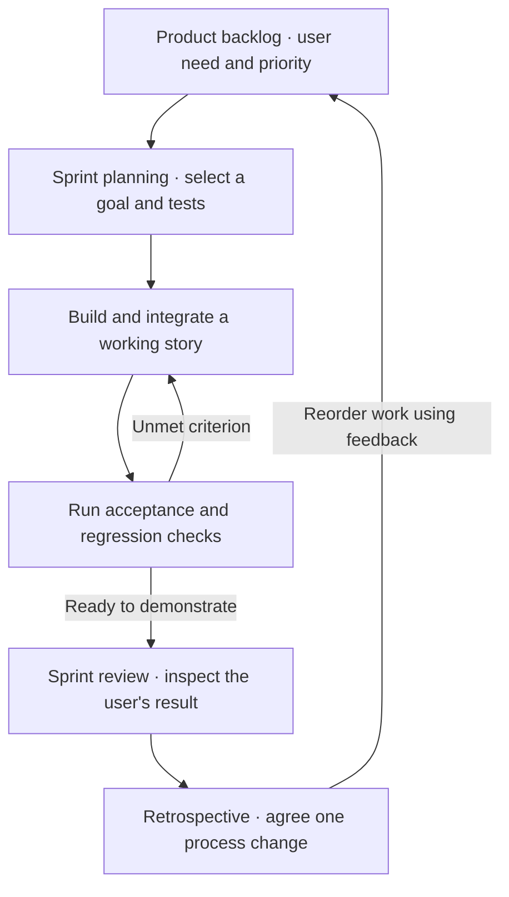
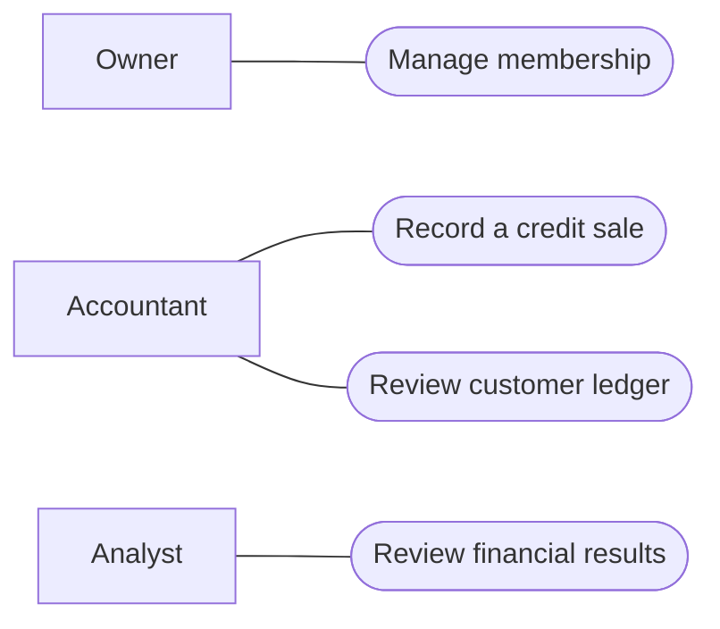
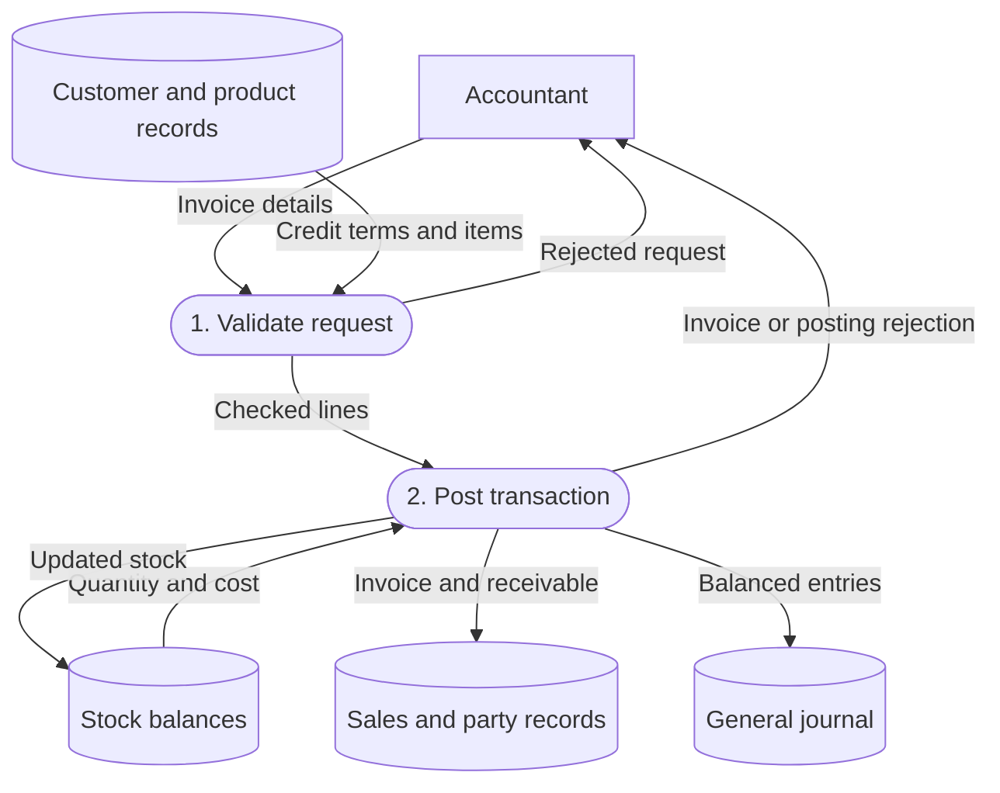
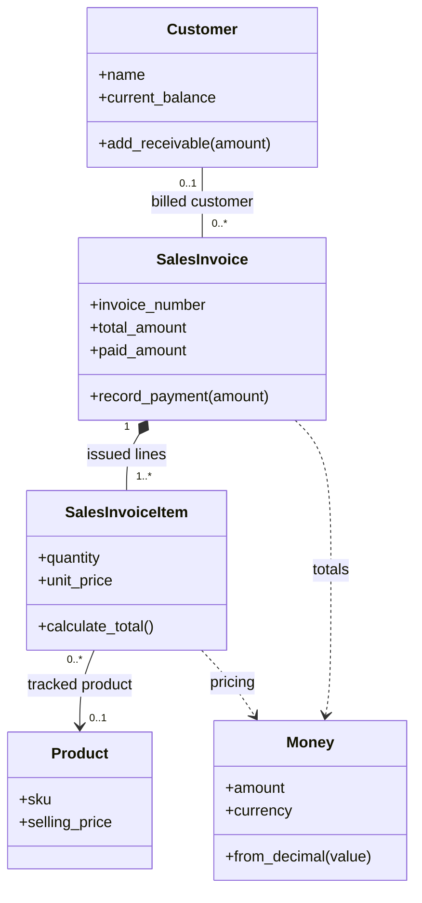
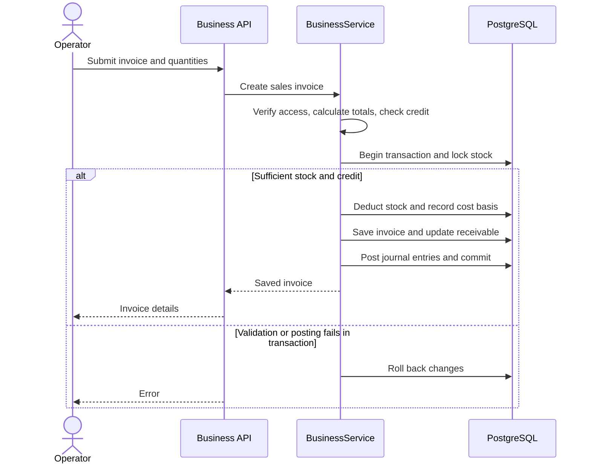
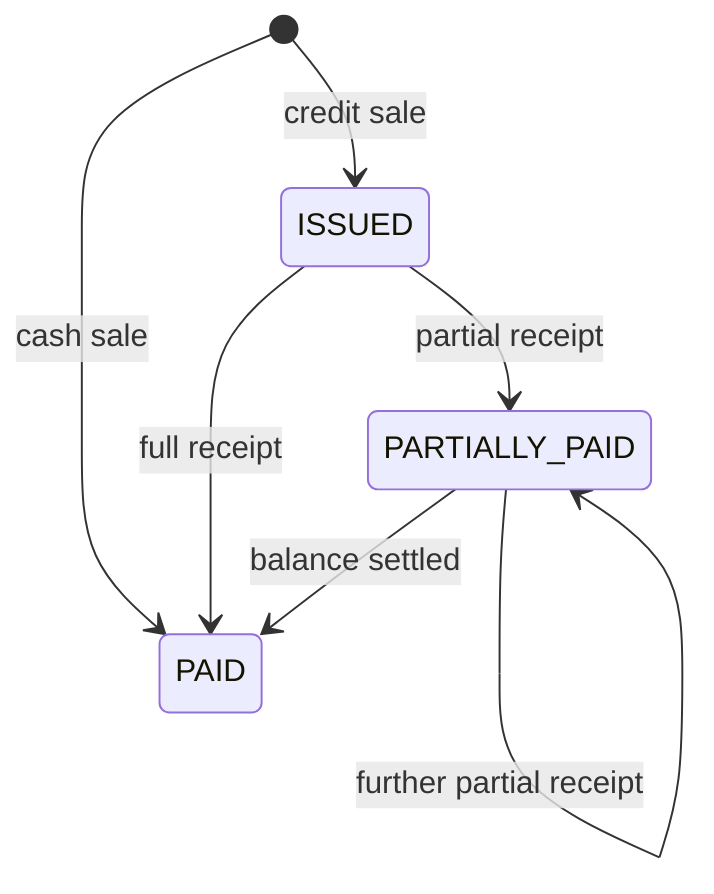
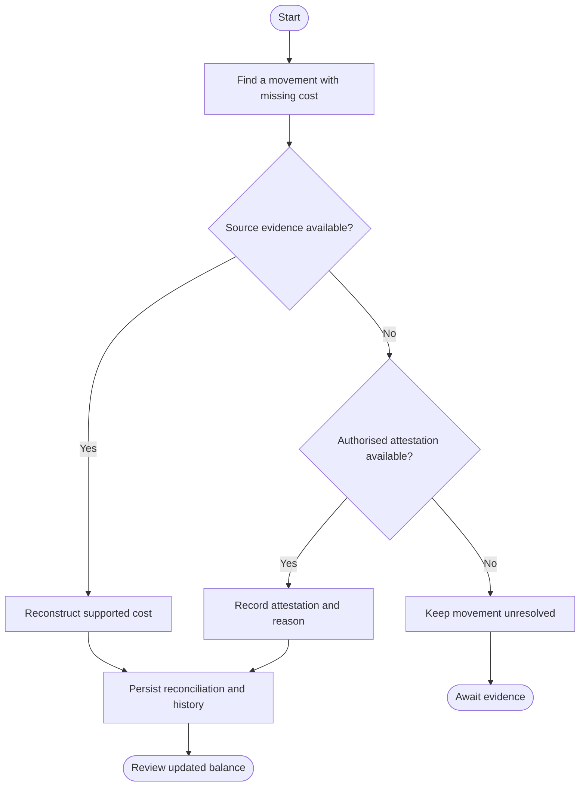
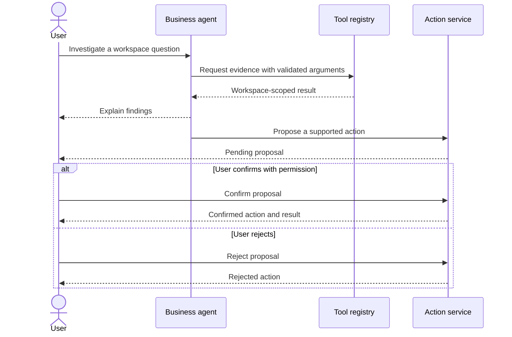
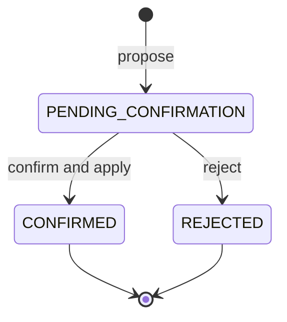

# ArthLens (अर्थLens)

**Business operations and financial decision support for small enterprises.** Record a purchase, issue a credit invoice, see what the customer owes, and trace the result to stock and journal entries in the same workspace. From those records, an owner can compare decisions, replay a scenario and review an AI-proposed action before it takes effect.

[Open the web app](https://arthlens-two.vercel.app) · [Backend deployment](https://arthlens-n6ah.onrender.com) · [Run locally](#run-locally) · [Walk through a sale](#evaluation-walkthrough)

| Explore the product | Follow the Agile project |
|---|---|
| [Workspace and system boundary](#the-workspace) | [Lifecycle, roles and backlog](#agile-development-lifecycle) |
| [Technology and architecture](#technology-and-architecture) | [Sprint 1 · Workspace access](#sprint-1--workspace-access) |
| [Financial rules and object model](#financial-rules-and-object-model) | [Sprint 2 · Posting a sale](#sprint-2--posting-a-sale) |
| [Financial analysis and scenarios](#sprint-3--financial-analysis-and-scenario-replay) | [Sprint 3 · Analysis and replay](#sprint-3--financial-analysis-and-scenario-replay) |
| [Agent actions and reports](#sprint-4--agent-actions-and-reports) | [Sprint 4 · Approval and reporting](#sprint-4--agent-actions-and-reports) |
| [Verification and local setup](#release-testing) | [Planning and control](#planning-and-control) · [Release and maintenance](#release-testing) |

## The workspace

A shop can record a credit sale in its billing system and still omit the amount from the customer's Khata. A second operator can sell the same remaining stock before the first operator finishes. A report built from either partial record can overstate cash or margin. ArthLens treats these as requirements for consistency, concurrency control and traceability.

| User task | Workspace modules | Observable result |
|---|---|---|
| Record what was bought, sold or returned | Suppliers, purchases, inventory, sales, customers, Khata | Stock, party balances and the general ledger reflect the commercial event. |
| Understand the business | Finance, analytics, reports, constellation | The operator can inspect financial results and export evidence. |
| Evaluate a change | Decisions, scenarios, goals | The workspace can retain a decision version, replay a seeded scenario and check progress against a goal. |
| Control who can act | Workspace overview, members, settings, audit, agent | Requests are scoped to the workspace. Proposed agent actions can be reviewed before execution. |

**System boundary.** The assessed prototype covers the path from a business transaction to a report or a reviewed decision. It relies on a browser, a server and a relational database. Identity, email and model providers are external integrations. Statutory filing, actual bank settlement and an independently audited financial statement are outside this demonstration. Explore the [workspace routes](frontend/app/workspaces/%5Bid%5D) and the [business API](backend/arthlens/api/business.py) for the available operations.

For example, the **sales** page answers “What did we bill?”, **Khata** answers “Who owes us money?”, and **inventory** answers “How much stock remains and at what cost?” A credit invoice can increase revenue and receivables while cash stays unchanged. In a review, show all three screens for the same transaction before interpreting a financial dashboard.

## Technology and architecture

ArthLens uses a client/server architecture. Next.js presents the workspace and sends HTTP requests. FastAPI authenticates the caller, validates the request and invokes application services. Services coordinate domain rules and repositories. PostgreSQL persists changes, with Alembic maintaining the schema. Financial and decision modules compute results used by reports and the agent. The browser presents outcomes while the server enforces access and correctness.

| Component | Responsibility | Boundary and design decision |
|---|---|---|
| [Web client](frontend/app) and [API](backend/arthlens/api) | Navigation, forms, HTTP validation, authorisation and response formatting | A client can preview a value. The server recalculates or validates values it will persist. |
| [Domain](backend/arthlens/domain) | Money, invoice items, inventory balances, journal entries and their rules | A domain object can be tested without starting a web server. |
| [Application services](backend/arthlens/services) and [infrastructure](backend/arthlens/infra) | Coordinate workflows and persist state | Multiple repositories can share one transaction. Splitting inventory, billing and posting into independently committed writes would risk partial sales. |
| [Finance](backend/arthlens/finance), [decisions](backend/arthlens/decision) and [reporting](backend/arthlens/reporting) | Compute indicators, compare alternatives, render evidence | Stored inputs and computed results can be inspected independently of how a screen or PDF presents them. |
| [Agent](backend/arthlens/agent) and [action service](backend/arthlens/services/agent_action_service.py) | Investigate with tools and stage permitted actions | The model can propose an action. The service checks its payload and state before applying it. |



The Next.js client uses TypeScript, ECharts for charts and Framer Motion for interface transitions. The Python backend owns posting rules, authorisation and transaction boundaries. Alembic versions the database schema. The [frontend manifest](frontend/package.json), [backend dependencies](backend/pyproject.toml) and [CI configuration](.github/workflows/ci.yml) record the versions and build environment.

## Agile development lifecycle

**Agile is the project's chosen SDLC.** The delivery unit is a working user story that crosses the interface, API, domain rules and storage. A critical requirement such as “a failed sale leaves stock unchanged” travels with the story, from discovery through review. A change in a later sprint can refine a decision made in an earlier one. For instance, recording a movement's cost solves new sales, while reconciling movements already missing cost requires a separate story with its own evidence.

The four sprint goals below organize the implemented features into a **proposed course delivery plan**. Source and tests are evidence of functionality. Dates of ceremonies, actual velocity and stakeholder sign-off are not recorded. This distinction matters when judging project progress.



| Agile practice | How the three-person team can apply it |
|---|---|
| Product ownership and refinement | One member maintains the ordered backlog and consults the accountant or owner on ambiguities. Ask whether a cash sale or a credit sale should be used in the acceptance example. Capture the answer alongside the story. |
| Sprint planning | Choose a demonstrable goal, identify data and API dependencies, estimate the work, and reserve time for testing. A single invoice story includes a valid sale, a rejected sale and a review of the ledger. |
| Daily coordination | The three members share progress towards the goal, blockers and the next integration point. If database setup blocks posting tests, make it visible before adding UI work. |
| Implementation and inspection | Split work by domain/data, API/integration and interface/testing. Rotate peer review. Inspect authorisation and transaction boundaries before merging a change to a financial workflow. |
| Review and retrospective | Demonstrate the result with known inputs. Record whether it met the acceptance criteria. Put new requests back in the backlog. Separately identify one process improvement, give it an owner, and check its effect next sprint. |

**Definition of ready.** A story names the actor and workspace, states the preconditions, includes one expected outcome and one exception, and identifies a way to observe both. **Definition of done.** Review the code and changed contract, pass the relevant tests against a known schema, demonstrate the outcome, and record outstanding limitations. A slide or a completed form alone does not establish that a transaction posted correctly.

### Product backlog and requirements

| ID and proposed order | User story | Sprint review evidence |
|---|---|---|
| AL-01 · Must | As an owner, I can admit a member with a limited role so that my business remains isolated. | One permitted operation and the same request from an unauthorised identity. |
| AL-02 · Must | As an accountant, I can post a credit sale so that stock, customer dues and journals agree. | Before/after balances on a successful sale and on a failed multi-line sale. |
| AL-03 · Must | As an operator, I can return purchased stock against its source and resolve missing cost evidence. | Partial return, repeated request and reconciliation history. |
| AL-04 · Should | As an analyst, I can replay an earlier scenario and explain a goal deviation. | Stored seed/version, replay result and a comparison with ledger-derived actuals. |
| AL-05 · Should | As an owner, I can review a proposed goal before it changes my workspace. | Pending proposal, explicit confirmation or rejection, and recorded outcome. |

**Elicitation and SRS.** Use a walk-through of a real invoice to discover data fields, observation of a partial return to identify exceptions, and a prototype review to validate vocabulary such as “due” versus “paid”. These are suggested techniques for the team. Write each result as a verifiable requirement. “Inventory must work correctly” becomes “when the second invoice line exceeds available stock, persist neither the invoice nor the first deduction.” Separate functional behaviour from quality constraints such as monetary precision, transaction atomicity, tenant isolation and reproducible results.

| Requirement | Constraint or exception | Acceptance evidence |
|---|---|---|
| Record a credit invoice and its financial effects together. | Caller has a permitted role, products belong to the business, credit and stock checks pass. | Insufficient stock on a later line undoes earlier deductions. [Transaction tests](backend/tests/integration/test_business_transaction_integrity.py) |
| Return purchased stock against its source. | The same request cannot refund the same quantity twice. Source value and tax determine the return. | Check partial, repeated and concurrent returns against the original purchase. [Transaction tests](backend/tests/integration/test_business_transaction_integrity.py) |
| Preserve financial assumptions for repeat review. | A replay uses stored scenario-version inputs and random seed. | Compare the replayed run with its originating version. [Scenario service](backend/arthlens/services/scenario_service.py) · [Decision API tests](backend/tests/integration/test_decision_api.py) |
| Explicitly approve an agent-proposed change. | The pending proposal belongs to a workspace and session. An already resolved action cannot be confirmed again. | Proposing a goal creates a pending action. Confirmation creates the goal and records its resource ID. [API test](backend/tests/integration/test_agent_and_reports_api.py) |
| Control access throughout the lifecycle. | A valid identity alone does not establish authority over a different business. | Exercise allowed and forbidden role/operation combinations. [RBAC contract](backend/tests/contract/test_rbac_matrix.py) |

## Sprint 1 · Workspace access

**Goal:** an owner can open a workspace and give a member an appropriate level of access. The identity boundary answers who is calling. The membership and role checks answer what that person may do in this specific business. The domain defines owner, admin, manager, accountant, analyst and viewer roles. Route-level permissions can differ by operation. [Domain definitions](backend/arthlens/domain/business.py) · [Access matrix tests](backend/tests/contract/test_rbac_matrix.py)

**Use-case view.** The lines connect representative actors to their purposes. This is a simplified view of user goals rather than the complete permission matrix.



**Acceptance and review.** Use two businesses, one permitted member and one attempted cross-business request. Confirm that a valid login for the first workspace cannot reveal the second workspace’s records. Role-change and archival stories must also cover later requests from an existing session. See [workspace governance](backend/tests/unit/test_workspace_governance.py) and [role freshness](backend/tests/integration/test_jwt_role_freshness.py).

## Sprint 2 · Posting a sale

**Goal:** a credit sale leaves one coherent financial record. An accountant submits invoice lines, the service checks membership, stock and credit, and a single database transaction saves the sale. The result is visible in inventory, customer dues and the journal. The return story reuses the purchase line as evidence for quantity and value. [Business service](backend/arthlens/services/business_service.py) · [Transaction integrity tests](backend/tests/integration/test_business_transaction_integrity.py)

### Structured analysis and design

The **context DFD** shows the operator and the information exchanged. The **level-one DFD** opens that same sale process. Both have the same external input and output; stock records and journals are internal data stores. Arrows represent information. The sequence diagram below describes time order separately.




**From DFD to structure chart.** Transform the posting process into responsibilities a reviewer can assign and test. The chart describes logical functions within the service.

```text
create_sales_invoice
├── check role, workspace, products and customer credit
├── build invoice lines and calculate totals
└── execute one transaction
    ├── deduct tracked stock and record its cost
    ├── persist invoice and items
    ├── update customer receivable
    └── post balanced journal entries
```

**Data dictionary.** `quantity` is a decimal number of units. `unit_price` is money per unit. `total_amount` is the invoice value after tax and discount. `paid_amount` is the amount settled so far. `reference_id` on a sale movement links back to the invoice. A movement’s `cost_basis` captures its valuation at the time of sale. Substituting the selling price here would distort gross margin.

Top-down design partitions the sale into validation, valuation and posting. Bottom-up design reuses tested money and stock operations. Functional cohesion is visible in the scenario service, which owns scenario versions and runs. Passing a business ID and a quantity is data coupling. Passing a whole invoice when only its ID is needed introduces a dependency on its structure (stamp coupling). Sharing a session across repositories is deliberate coupling so a posting failure can roll back all writes. [Domain fields](backend/arthlens/domain/business.py) · [Service orchestration](backend/arthlens/services/business_service.py)

### Financial rules and object model

| Rule | Worked example or acceptance condition | Owner in the implementation |
|---|---|---|
| Monetary precision | In INR, constructing `Money` from the decimal string `"12.345"` gives ₹12.35 using half-up rounding. Adding amounts in different currencies raises an error. | [Money](backend/arthlens/domain/business.py) |
| Stock valuation | Ten units costing ₹60 each plus ten at ₹80 give 20 units valued at ₹1,400. The weighted-average unit cost is ₹70. A subsequent sale of two tracked units captures ₹140 of cost. | [InventoryBalance](backend/arthlens/domain/business.py) and [sales posting](backend/arthlens/services/business_service.py) |
| Journal balance | A ₹200 credit sale with zero tax debits receivables and credits revenue by ₹200. A separate posting debits cost of goods sold and credits inventory at the sale-time cost. Each journal entry must balance on its own. | [JournalEntry](backend/arthlens/domain/business.py) |
| Scenario reproducibility | Store the version, baseline snapshot, distribution assumptions, iteration count and seed with the run. Replaying those inputs provides a comparison against the recorded result. | [ScenarioService](backend/arthlens/services/scenario_service.py) |

#### Object-oriented principles in the implementation

| Principle | Concrete example | Why it matters |
|---|---|---|
| Classes, instances and construction | Each `SalesInvoiceItem` instance has its own quantity, price and discount. `Money.__post_init__` normalises an amount to two decimal places. | Construction establishes the monetary representation used by subsequent calculations. |
| Encapsulation | `SalesInvoice.record_payment()` updates the paid amount and payment status. `InventoryBalance.apply_deduction()` checks the quantity. | Callers can reuse a rule through a named operation. Persistence and access checks still belong to the service. |
| Abstraction | `UserRepository` defines a persistence contract. `ILLMClient` defines the model-client boundary. | Callers can depend on the operation without knowing the storage or provider details. |
| Inheritance | `PostgresUserRepository` implements `UserRepository`. `UserAlreadyExistsError` specialises `RepositoryError`. | Implementations share a contract and callers can handle a family of failures. |
| Polymorphism | Gemini, deterministic and replay clients implement the model-client interface. | The same caller can use a live provider for a demonstration and a repeatable client for tests. |

Composition appears in the invoice and its line items. Association appears in the optional invoice-to-customer link. A workspace groups users through membership records. A user has an identity independent of any one membership, an example of aggregation at the domain level. [Domain entities](backend/arthlens/domain/business.py) · [Repository contracts](backend/arthlens/domain/repositories.py) · [Provider implementations](backend/arthlens/llm/provider.py)

**UML class view.** Read from customer to invoice to line item. A customer is optional on an invoice, and a line item may refer to a tracked product. The filled diamond denotes line ownership.



**UML sequence of a credit sale.** The database lifeline groups repositories that share a transaction. The error branch illustrates why a second-line shortage cannot leave the first line deducted.



**Invoice settlement states.** This view covers issue, partial receipt and full settlement. Other domain statuses include draft, overdue and cancelled.



### Review exercise · trace ₹200 through the workspace

Start with ten units at ₹60 each. Sell two on credit for ₹100 per unit with no tax or discount. Stock falls to eight units, receivables rise by ₹200 and the sale contributes ₹80 gross profit after ₹120 of cost. Cash is unchanged until payment. Repeat with an unavailable quantity and compare all three records with their starting values. A single pass through the happy path cannot validate the rollback requirement.

## Sprint 3 · Financial analysis and scenario replay

**Goal:** an analyst can trace a reported number to operational evidence and reproduce a what-if result. Financial statements use posted records. Scenarios use a saved version of the assumptions, a baseline snapshot, distribution settings and a seed. They answer different questions: “What did we record?” and “What happens under these assumptions?”

| Product capability | How the result is constructed | Acceptance check |
|---|---|---|
| Cost reconciliation | Find a historical movement without usable cost, reconstruct from supported evidence or record an authorised attestation, and retain a history of the adjustment. | A reviewer can identify the movement, how its cost was obtained and what changed. [Cost service](backend/arthlens/services/inventory_cost_service.py) |
| Scenario replay | Save the version and baseline hash, store the seed and iterations, and evaluate the distributions using those inputs. | Repeating the same inputs and seed reproduces the result. [Scenario service](backend/arthlens/services/scenario_service.py) · [Engine tests](backend/tests/unit/test_scenario_engine.py) |
| Goal deviation | Compare planned and actual progress. For profit goals, compare ledger results between equal-length periods and identify revenue, cost and expense movements. | Explain the plan gap separately from what moved since the prior period. [Goal service](backend/arthlens/services/goal_planning_service.py) · [Goal tests](backend/tests/unit/test_goal_planning.py) |

**Activity view for missing cost.** The decision points distinguish a supported reconstruction from a case that must await evidence.



**Sprint review.** Save a scenario and its first run, change an assumption in a new version, then replay the earlier run. Review the original version's evidence alongside the new result. Add any request for a different distribution or metric to refinement with a numerical acceptance example.

## Sprint 4 · Agent actions and reports

**Goal:** a user can investigate a financial question, review a proposed change and export evidence. The tool registry supplies workspace-scoped operations. Parameter provenance connects an input to its source. A missing parameter should lead to clarification. A proposed goal, task or report must retain its scope and status while waiting for a human decision. [Tool registry](backend/arthlens/agent/business_tools.py) · [Action service](backend/arthlens/services/agent_action_service.py)

**Interaction sequence.** Read downward. Investigation provides evidence first. Confirmation is a separate user operation.



**Proposal state machine.** Confirmation locks the pending action while recording its result. A second confirmation must not create another resource.



**Review evidence.** Compare the goal list before the proposal, after the proposal and after confirmation. Export the resulting report and inspect a figure against the source transaction. Agent tests also exercise clarification and replanning after a tool error. [Agent evaluation](backend/tests/agent_eval/test_agent_investigation_eval.py) · [Reports and confirmation tests](backend/tests/integration/test_agent_and_reports_api.py)

## Planning and control

**Release plan for the course team.** A workable planning baseline is four one-week sprints for the goals above, with backlog refinement and regression testing every week. Reserve a further week for integration, demo rehearsal and release defects. These are estimates. Sprint reviews can change the order or scope. Team responsibilities cover product/domain clarification, application/data services, and interface/verification. The three contributors can rotate responsibility for facilitating each review.

| Scheduling decision | Example in ArthLens |
|---|---|
| Work breakdown and dependency network | For AL-02, define a fixture and expected ledger first. Domain arithmetic and the API schema can then proceed in parallel. Transaction integration waits for the posting rules. The final workflow test depends on the integrated service. |
| Critical path | A delay in shared-transaction posting blocks the rollback demonstration and downstream analytics. A delay in chart styling need not block posting acceptance. Record durations and dependencies before claiming a numerical critical path. |
| Uncertain estimates | For a reconciliation fixture, illustrative optimistic, likely and pessimistic estimates of 1, 2 and 6 person-days yield a PERT estimate of (1 + 4×2 + 6) / 6 = 2.5 person-days. Re-estimate after examining the historical records. |
| Monitor and control | Track accepted stories against the sprint goal, open defects by severity, and blockers by age. If a schema change is late, retain its integrity tests and move a lower-priority interface improvement out of the sprint. Record the change and its reason. |

### Size and effort measurement

These are measured examples at source revision `2891aaf`. The scope is deliberately small so a reviewer can repeat the count.

| Python source file | Physical LOC | Lexical tokens | Function definitions |
|---|---:|---:|---:|
| [Domain entities](backend/arthlens/domain/business.py) | 777 | 4,113 | 45 |
| [Scenario service](backend/arthlens/services/scenario_service.py) | 234 | 2,002 | 14 |
| [Action service](backend/arthlens/services/agent_action_service.py) | 258 | 2,112 | 9 |

LOC includes blank lines and comments. Token count uses Python's tokenizer, excluding comments, encoding, indentation, newline and end markers. Function count includes synchronous and asynchronous definitions, methods and nested functions from the Python syntax tree. These measures describe size, not quality or productivity. A function-point estimate would separately count user-visible inputs (invoice submission), outputs (report), queries (Khata lookup), logical files (invoices) and external interfaces. Function definitions are not function points.

**COCOMO classroom estimate.** The three measured files total 1.269 physical KLOC. Using this as a rough size proxy in Basic COCOMO's organic mode gives effort ≈ `2.4 × 1.269^1.05 = 3.08 person-months` and duration ≈ `2.5 × 3.08^0.38 = 3.83 months`. A money estimate would multiply effort by a stated cost per person-month. Physical LOC includes non-executable lines, and the sample excludes the frontend, database and integration work. The result illustrates the model, not observed team effort or a forecast for the sprint schedule. For scheduling, estimate work packages, account for dependencies and revise after each milestone.

### Risk and quality during a sprint

| Risk | Design or control | Evidence or next measurement |
|---|---|---|
| A partial sale leaves stock and ledgers inconsistent | Shared transaction, balance validation and rollback | Exercise a shortage on the second line and compare pre/post balances. |
| Concurrent returns exceed the purchased quantity | Validate source quantity under transactional controls | Run the concurrent returns case in the [integrity suite](backend/tests/integration/test_business_transaction_integrity.py). |
| A valid user reads another workspace | Scope queries and check permissions at the service/API boundary | [Tenant tests](backend/tests/integration/test_agent_tenant_security.py) and [role matrix](backend/tests/contract/test_rbac_matrix.py). |
| Missing cost distorts gross margin | Preserve movement cost evidence and reconciliation history | Inspect an unresolved movement and its reviewed adjustment. [Cost service](backend/arthlens/services/inventory_cost_service.py) |
| Provider output changes between runs | Exercise deterministic paths and inspect provenance before accepting tool inputs | [Agent evaluations](backend/tests/agent_eval/test_agent_investigation_eval.py). Evaluate live-provider behaviour separately. |
| A schema change breaks an existing installation | Version migrations and exercise upgrades on a disposable database | [Migration tests](backend/tests/integration/test_migrations.py). Rehearse restore on a separate copy before release. |

**Quality attributes.** Reliability concerns whether a completed operation meets its contract over repeated use. Security adds identity, authorisation and tenant isolation. Maintainability depends on clear ownership of rules, migration history and regression tests. For usability, ask a first-time operator to enter a credit sale and find the resulting due balance without help. For performance, measure p95 invoice latency and failure rate under a stated concurrency level, database size and hardware configuration. The latter two are proposed evaluations.

**Reliability metrics and models.** Track failed valid requests / total valid requests, time between service failures and mean time to restore. Keep rejected invalid inputs separate from service failures. Availability can be estimated from uptime / observation time. A reliability-growth model such as Musa–Okumoto could fit cumulative failures against execution time during repeated release testing. It requires a consistent workload and failure log. The suite pass count alone supplies neither an uptime figure nor a fitted model.

**Process quality.** The ISO 9000 family provides a framework for quality management. In this project, traceability, review records and corrective actions are examples of evidence one could inspect against a quality process. ISO 9001 certification would require an external assessment. The SEI Capability Maturity Model distinguishes initial, repeatable, defined, managed and optimising processes. Versioned tests show repeatable work. A defined release procedure, trend measurements and documented improvements would support assessment of later stages. No certification or maturity rating is claimed.

## Release testing

**Verification** asks whether the implementation satisfies a specification. **Validation** asks whether the resulting workflow solves the operator's problem. Checking that a journal balances verifies an invariant. Asking an accountant to trace an unpaid invoice to the correct Khata entry validates the workflow.

| Test case and level | Setup and input | Expected observation and evidence |
|---|---|---|
| Unit · monetary arithmetic | Generate amounts, construct value objects and compose additions, subtractions or integer multiplications. | Values stay quantised to two decimals and satisfy the tested arithmetic properties. [Property tests](backend/tests/unit/test_money_property_invariants.py) |
| Contract · workspace roles | Repeat the same operation as an allowed and a restricted role. | The permission decision matches the role/operation matrix. [Contract tests](backend/tests/contract/test_rbac_matrix.py) |
| Integration · atomic sale | Seed stock for the first invoice line and insufficient stock for a later line. | Invoice creation fails and earlier stock deductions are rolled back. [Transaction tests](backend/tests/integration/test_business_transaction_integrity.py) |
| Integration · schema evolution | Start at a supported predecessor and upgrade an isolated database. | The expected revision, columns and tables exist. [Migration tests](backend/tests/integration/test_migrations.py) |
| System · business lifecycle | Create a workspace, record commercial events, analyse finances and export. | Outputs remain linked across the complete journey. [Lifecycle test](backend/tests/e2e/test_full_platform_lifecycle.py) |
| Browser and agent validation | Exercise authentication and operations in a browser. Separately supply an incomplete request to the agent. | Browser journeys reach user-visible results. The agent asks for missing data or retains a proposal pending confirmation. [Playwright](frontend/e2e) · [Agent eval](backend/tests/agent_eval/test_agent_investigation_eval.py) |

**Testing strategies.** Bottom-up integration starts with money, inventory and journal rules, then adds repositories and a real database. Top-down integration starts from a user or HTTP request and substitutes a controlled provider. The browser journey joins the layers. Functional testing asserts visible outcomes such as the exported report. Structural testing selects branches such as cash versus credit or the exception path after a stock deduction. Branch coverage would need an instrumented run and a stated denominator.

**Inspection and debugging.** In a code review of a purchase return, trace the original purchase line, quantity limit, transaction boundary and journal posting. For a reported mismatch, capture a minimal fixture, reproduce it against the same schema, inspect stock movements and journal lines, isolate the first inconsistent write, fix the responsible layer and retain the fixture as a regression test. An internal seeded walkthrough is a suitable alpha exercise. A beta would ask representative operators to use a trial workspace and record task failures before release. Formal alpha/beta results are not documented here.

### Designing tests from the same story

**Black-box test design.** Treat a credit sale as an input/output contract. With ten units on hand and sufficient credit, positive quantities up to ten form an admissible stock partition. Quantities above ten form a shortage partition. For whole-unit examples, try 9, 10 and 11 while holding price, role and customer constant. The first two should post and 11 should fail without changing stock or the journal. Test zero and negative quantities separately from shortage. A second dimension is access: a stock-valid sale submitted by an unauthorised user must still fail. These are test-design examples; the linked suite identifies the cases already automated.

**White-box test design.** In `InventoryBalance.apply_deduction`, trace (1) non-positive quantity, (2) positive but insufficient quantity with negative stock disallowed, (3) sufficient quantity, and (4) insufficient quantity with negative stock explicitly allowed. Decision coverage exercises both outcomes of the shortage guard. Condition coverage additionally varies the permission flag and the stock comparison. At service level, the multi-line rollback test follows a path where one write succeeds before a later check fails. Statement coverage alone cannot establish that the first write was undone. [Deduction code](backend/arthlens/domain/business.py) · [Rollback tests](backend/tests/integration/test_business_transaction_integrity.py)

**Example test plan for AL-02.** Scope the run to a tracked product and a credit invoice. Use an isolated migrated PostgreSQL database, authorised test member and known opening quantities. Capture invoice IDs, stock, receivables and journal totals before and after the request. Suspend the run if the schema or fixture is wrong. Exit when the valid sale and rollback cases pass, balances reconcile, and blocking defects have been resolved and retested. The test record should identify the revision, environment, inputs, expected and actual result, and defect reference. This makes results from two environments comparable.

**System tests for release review.** Run one business lifecycle against the integrated stack, then exercise cross-workspace access and an invalid confirmation. Recovery testing can interrupt a posting in a disposable environment and inspect the rollback. A separate load test would run concurrent sales on the same SKU and measure latency, errors and final stock. Browser automation, transaction tests and load measurements answer different questions.

**Historical baseline.** The local test record of 12 November 2026 reported 291 backend tests, 23 Vitest tests, five Playwright tests and seven smoke checks passing. The backend count used the deterministic provider. Record a fresh run with its commit and configuration before using these figures for a new release. [CI workflow](.github/workflows/ci.yml) · [Backend suites](backend/tests) · [Browser suites](frontend/e2e)

## Run locally

Use Python and Node versions aligned with [CI](.github/workflows/ci.yml) (Python 3.14 and Node 20 in that configuration). Provide PostgreSQL/PostGIS through Docker or the supported local Windows installation. Configure development values from the [root environment example](.env.example) and [frontend example](frontend/.env.example). Keep real credentials out of version control.

From the repository root on Windows, install dependencies once and start the application:

```powershell
python -m venv .venv
.\.venv\Scripts\python.exe -m pip install -e "./backend[dev]"
npm ci --prefix frontend
.\run-local.ps1 -Wait
```

Open the client at `http://localhost:3000`. The [launcher](run-local.ps1) checks the database, applies migrations, seeds local demo accounts and starts the services. Stop them from another terminal with `.\stop-local.ps1`. The [deployment environment example](deployment/env.example) and [preflight script](scripts/deployment_preflight.py) describe the release configuration.

For local verification, configure a **dedicated test database** using the [backend test configuration](backend/tests/conftest.py). In the repository virtual environment, run:

```powershell
$env:LLM_PROVIDER = "deterministic"
.\.venv\Scripts\python.exe -m pytest backend/tests -v
```

From `frontend/`, run `npm test -- --run` and `npm run build`. For Playwright, install Chromium with `npx playwright install chromium` and follow the [browser test configuration](frontend/playwright.config.ts). Record the commit, provider, migration head, environment and failures alongside the result.

On Linux or macOS with Docker Compose available, the repository provides [start.sh](start.sh) and [stop.sh](stop.sh). From the project root use `bash start.sh` to launch the stack and `bash stop.sh` to stop it. The [smoke checks](deployment/smoke/run_smoke_checks.py) exercise a running deployment. Review their environment and account settings before running them against a disposable workspace.

## Maintenance backlog

| Maintenance category | ArthLens example | Change and release control |
|---|---|---|
| Corrective | A partial return allocates the wrong tax amount. | Reproduce with a minimal purchase, fix the allocation, rerun return and ledger tests. |
| Adaptive | Identity-provider configuration or the database platform changes. | Update configuration and preflight together, then test login or upgrade against a representative environment. |
| Perfective | Operators need a more informative goal deviation report. | Agree on the expected output, extend the goal service, update the report and test the full workflow. |
| Preventive | Older stock movements lack cost provenance. | Detect incomplete records, retain evidence for reconciliation and test historical replay. |

**Maintenance model and reuse.** A quick fix may restore a screen while leaving its report inconsistent. Plan a maintenance story with impact analysis, a regression test, a reviewed migration where necessary, and an updated handover. Reuse the money and journal rules across commercial operations. Reuse scenario snapshots for repeatable analysis. Reverse engineering here means tracing an existing route through service calls, database relationships and tests to recover its actual design. Re-engineering uses that recovered model to change the system safely, as in adding reconciliation records for legacy movements.

**Configuration management.** Git revisions identify source baselines, the npm lockfile pins frontend dependency resolution, and [Alembic revisions](backend/migrations/versions) order database changes. Review a change as one configuration item across code, schema, API contract, tests and documentation. Before deployment, check environment configuration and schema compatibility. After deployment, verify readiness and one end-to-end operation. For recovery, identify the compatible application version and rehearse database restoration on a copy before relying on the procedure.

At the next retrospective, review which defect escaped and why. For example, if a historical movement without a cost basis broke a reversal, add that fixture to the maintenance story, document the expected reconciliation behaviour and exercise both new and older records in the release check.

## Evaluation walkthrough

1. **Show the requirement.** Open a seeded workspace and select an inventory-tracked product. Note its starting quantity, unit cost and the customer's opening balance.
2. **Follow a credit sale.** With ten units at a unit cost of ₹60, sell two at ₹100 each with zero tax and discount. Expect eight units left, ₹200 added to receivables, ₹120 cost of goods sold and ₹80 gross profit on the sale. The revenue entry and cost entry must each balance. Stock additions use weighted-average cost, and the sale captures the unit cost at movement time.
3. **Test a failure.** Request more units than remain. Check that the invoice, stock and journal history did not change. Relate this check to the sequence diagram and the rollback integration test.
4. **Show reproducibility and approval.** Run and replay a seeded scenario. Propose a goal through the agent, inspect its pending state, confirm it and open the resulting resource.
5. **Close the trace.** Export a report and show the requirement, code path and test that support one reported figure.

### Course reading map

| Supplied lecture material | Application in this README |
|---|---|
| Weeks 1–5, introduction and process models; *Life Cycle Models*, Agile section, slides 101–109 | The [Agile lifecycle](#agile-development-lifecycle) turns customer involvement, short delivery cycles and feedback into a proposed sprint workflow. |
| Week 6, *Requirements Specification and Analysis*, especially traceability on slide 62 | Backlog IDs connect actors, exceptions and acceptance evidence. AL-02 follows one sale from requirement to rollback test. |
| Weeks 7–8, *Software Planning and Management*, scheduling and cost estimation | [Planning and control](#planning-and-control) distinguishes dependency order, measured size, uncertain estimates, and the team's release decision. |
| Weeks 9–10, structured analysis, DFDs, coupling, design and UML modelling | Context and level-one DFDs, data dictionary and structure chart describe the sale. Class, sequence, activity and state views answer separate design questions. |
| Weeks 11–13, testing background, system testing and preparing test plans | Release criteria cover test levels, environment, test data, suspension and the evidence to retain. |
| Weeks 14–15, white-box and black-box testing | Stock deduction illustrates control-flow paths, equivalence classes and boundary values for the same requirement. |

### Team · Software Engineering, IIIT Allahabad

| Team member | Roll number |
|---|---|
| Abhay Pratap Singh | IIT2025109 |
| Ayush Mishra | IIT2025108 |
| Mayank Puri | IIT2025104 |
