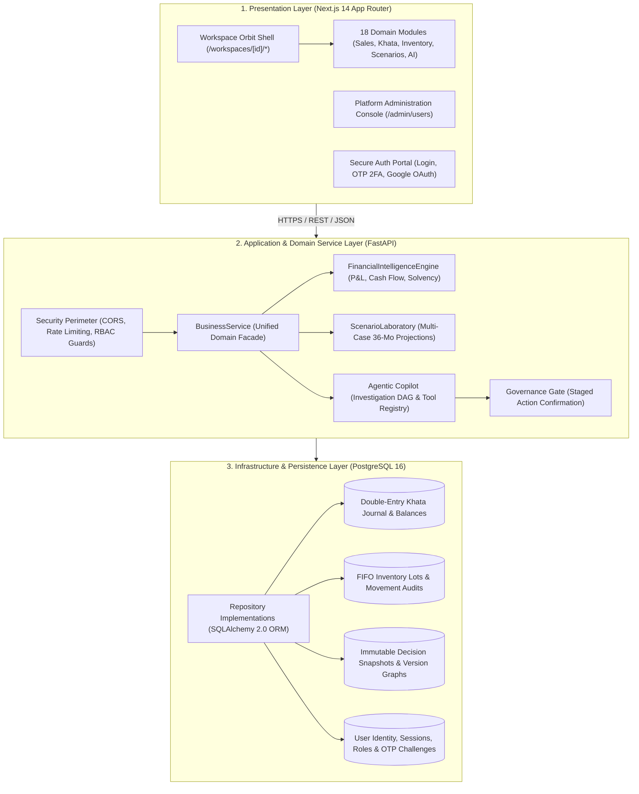
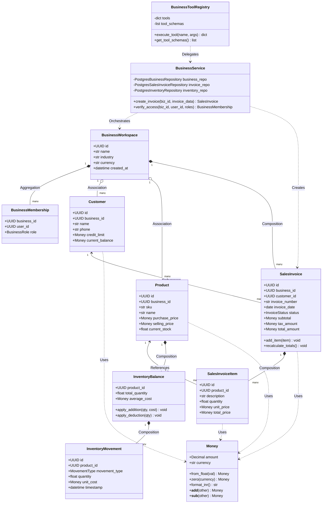
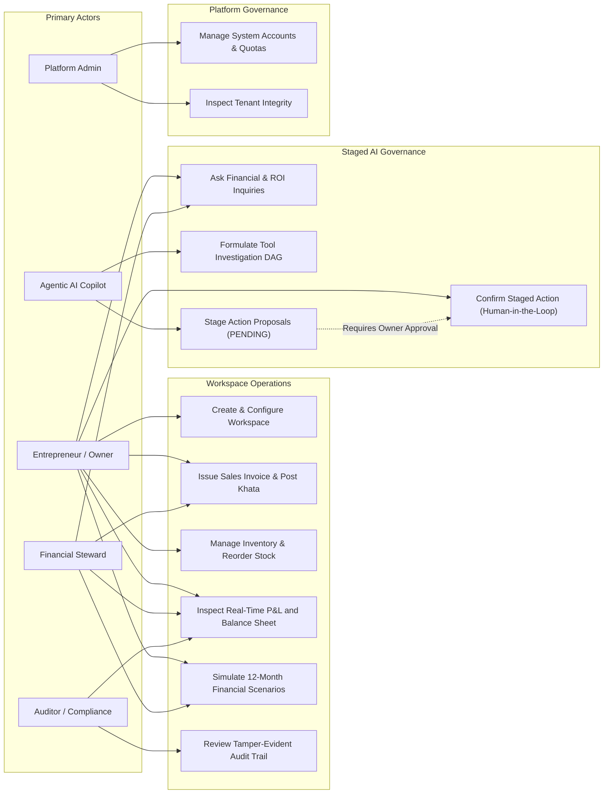
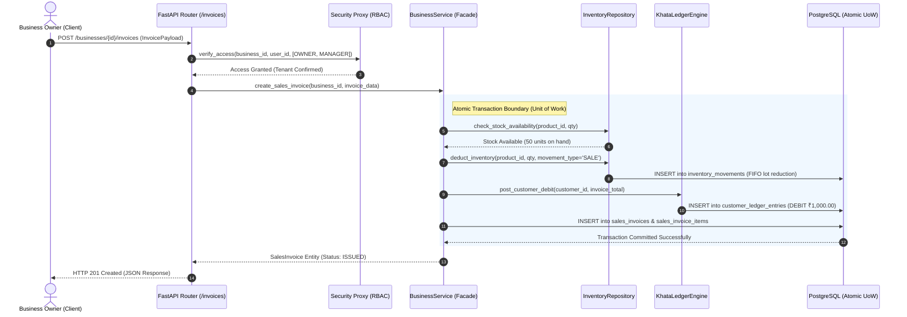
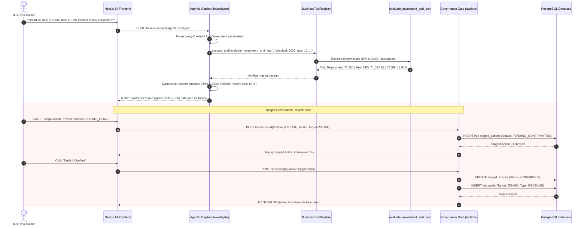
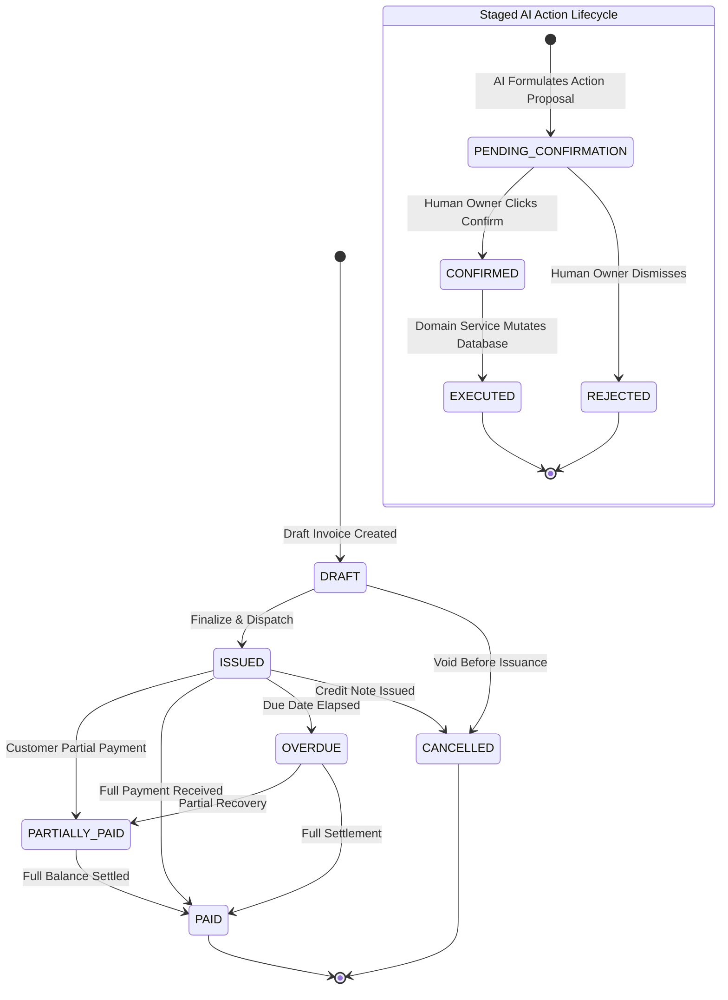

<div align="center">
  <h1>अर्थLens (ArthLens)</h1>
  <p><b>Sovereign Financial Operating System, Deterministic Integer-Paisa Khata & Staged AI Decision Intelligence Platform</b></p>
  <p><i>Academic Project Report & Object-Oriented Methodology (OOM) Specification</i></p>

  [](https://arthlens-two.vercel.app)
  [](https://arthlens-n6ah.onrender.com)
  [](https://github.com/ayush-mg/arthlens)
  [](https://github.com/ayush-mg/arthlens)
  [](https://github.com/ayush-mg/arthlens)
  [](https://github.com/ayush-mg/arthlens)
</div>

---

> **"Spreadsheets guess. Disconnected accounting tools drift. Generative AI hallucinates arithmetic. ArthLens binds sales, purchases, perpetual FIFO inventory lots, integer-paisa Khata double-entry ledgers, and human-in-the-loop AI governance into one living, mathematically locked operating system."**

ArthLens is an enterprise-grade sovereign business operating system and decision intelligence platform designed for Micro, Small, and Medium Enterprises (MSMEs), commercial operators, and financial stewards. It demonstrates an advanced implementation of **Object-Oriented Methodology (OOM)**, **Domain-Driven Design (DDD)**, and **SOLID architecture**, integrating deterministic financial arithmetic with agentic AI copilots.

---

## Table of Contents

1. [Executive Summary & Problem Statement](#1-executive-summary--problem-statement)
2. [Core Architectural Differentiators](#2-core-architectural-differentiators)
3. [System Architecture & Multi-Tier Topology](#3-system-architecture--multi-tier-topology)
4. [Object-Oriented Methodology (OOM) Deep Dive](#4-object-oriented-methodology-oom-deep-dive)
   - [4.1 Classes, Objects, Attributes, Methods & Constructors](#41-classes-objects-attributes-methods--constructors)
   - [4.2 The Four Pillars of Object-Oriented Programming](#42-the-four-pillars-of-object-oriented-programming)
   - [4.3 Relationships Between Classes (Association, Aggregation, Composition)](#43-relationships-between-classes-association-aggregation-composition)
   - [4.4 SOLID Object-Oriented Design Principles](#44-solid-object-oriented-design-principles)
   - [4.5 Software Design Patterns Catalog (23 Patterns Implemented)](#45-software-design-patterns-catalog-23-patterns-implemented)
   - [4.6 Exception Handling, Modularity & Defensive Programming](#46-exception-handling-modularity--defensive-programming)
5. [UML Diagrams](#5-uml-diagrams)
   - [5.1 Comprehensive Class Diagram](#51-comprehensive-class-diagram)
   - [5.2 Use-Case Diagram](#52-use-case-diagram)
   - [5.3 Sequence Diagram: Commercial Order-to-Ledger Execution](#53-sequence-diagram-commercial-order-to-ledger-execution)
   - [5.4 Sequence Diagram: Staged AI Investigation & Human Confirmation](#54-sequence-diagram-staged-ai-investigation--human-confirmation)
   - [5.5 State Diagram: Invoice & Staged Action Lifecycle Machines](#55-state-diagram-invoice--staged-action-lifecycle-machines)
6. [Platform Features & 18 Workspace Chapters](#6-platform-features--18-workspace-chapters)
7. [Deterministic Financial Engineering & Mathematics](#7-deterministic-financial-engineering--mathematics)
8. [Production Deployment & Verification Results](#8-production-deployment--verification-results)
9. [Local Quickstart & Execution Guide](#9-local-quickstart--execution-guide)
10. [Academic Handover & Team Credits](#10-academic-handover--team-credits)

---

## 1. Executive Summary & Problem Statement

India’s 63 million MSMEs contribute roughly 30% of the nation's GDP and 45% of total manufacturing output. Despite their economic criticality, the overwhelming majority operate under severe technological and financial vulnerabilities:

- **Disconnected Tool Sprawl**: Day-to-day operations are fragmented across physical paper ledgers (*Bahi-Khata*), desktop spreadsheet templates (Excel), and isolated billing apps. This creates reconciliation drift between what was billed, what left the warehouse, and what was collected.
- **Floating-Point Rounding Corruption**: Off-the-shelf web applications model financial balances using IEEE 754 floating-point numbers (`0.1 + 0.2 = 0.30000000000000004`). Over millions of transactions, rounding drift corrupts tax reporting, balance sheets, and audit verification.
- **Generative AI Hallucination in Finance**: LLM wrappers attempt to answer financial inquiries using raw token generation. Large language models cannot reliably calculate compounding annualized growth rates (CAGR), net present value (NPV), or debt service coverage ratios (DSCR), hallucinating plausible-sounding but financially catastrophic figures.
- **Uncontrolled Agent Mutations**: Emerging "autonomous AI agents" directly mutate database ledgers, risking unrecoverable financial write-offs and operational corruption without human oversight.

**ArthLens solves this through an uncompromising Object-Oriented design.** Financial transactions are modeled as immutable domain value objects; inventory movements follow strict FIFO/WAC aggregation rules; double-entry ledgers enforce algebraic conservation of value; and AI copilots are restricted behind a deterministic execution DAG and a human-gated confirmation lock.

---

## 2. Core Architectural Differentiators

```
┌────────────────────────────────────────────────────────────────────────┐
│                        ARTHLENS CORE GUARANTEES                        │
├───────────────────────────────┬────────────────────────────────────────┤
│ 1. Zero Math Hallucination    │ Deterministic Python calculation tools;│
│                               │ LLM strictly synthesizes explanations. │
├───────────────────────────────┼────────────────────────────────────────┤
│ 2. Integer-Paisa Precision    │ ₹1.00 = 100 paisa integer arithmetic;  │
│                               │ eliminates IEEE 754 floating drift.    │
├───────────────────────────────┼────────────────────────────────────────┤
│ 3. Staged Governance Gate     │ AI proposals stage in PENDING state;   │
│                               │ require explicit human owner confirm.  │
├───────────────────────────────┼────────────────────────────────────────┤
│ 4. Double-Entry Khata Ledger  │ Invariant: Total Debits == Total Credits│
│                               │ per transaction; tamper-evident audit. │
├───────────────────────────────┼────────────────────────────────────────┤
│ 5. Multi-Tenant IDOR Security │ Every query scoped to tenant UUID;     │
│                               │ deny-by-default role-based access.     │
└───────────────────────────────┴────────────────────────────────────────┘
```

---

## 3. System Architecture & Multi-Tier Topology

ArthLens is built as an enterprise three-tier web application adhering to clean architecture and Domain-Driven Design:



---

## 4. Object-Oriented Methodology (OOM) Deep Dive

ArthLens was designed from the ground up to demonstrate rigorous Object-Oriented methodology across the syllabus of OOM.

### 4.1 Classes, Objects, Attributes, Methods & Constructors

Every domain entity and service is modeled with explicit attributes, type annotations, and controlled constructors.

#### Concrete Implementation: The `Money` Value Object
In [`backend/arthlens/domain/business.py`](file:///c:/arthlens/backend/arthlens/domain/business.py#L121-L165):

```python
@dataclass(frozen=True)
class Money:
    """
    Immutable decimal-safe monetary representation.
    Encapsulates exact rounding and currency constraints.
    """
    amount: Decimal
    currency: str = "INR"

    def __post_init__(self):
        """Constructor validator ensuring strict 2-decimal half-up quantization."""
        dec = Decimal(str(self.amount)).quantize(Decimal("0.01"), rounding=ROUND_HALF_UP)
        object.__setattr__(self, "amount", dec)

    @classmethod
    def from_float(cls, val: float, currency: str = "INR") -> Money:
        return cls(Decimal(str(val)), currency)

    @classmethod
    def zero(cls, currency: str = "INR") -> Money:
        return cls(Decimal("0.00"), currency)

    def format_inr(self) -> str:
        """Formats the monetary amount into the Indian Lakh/Crore grouping system."""
        val = abs(self.amount)
        s, _, dec = f"{val:.2f}".partition(".")
        if len(s) > 3:
            last3 = s[-3:]
            rest = s[:-3]
            groups = []
            while len(rest) > 2:
                groups.insert(0, rest[-2:])
                rest = rest[:-2]
            if rest:
                groups.insert(0, rest)
            groups.append(last3)
            formatted = ",".join(groups)
        else:
            formatted = s
        prefix = "-" if self.amount < Decimal("0.00") else ""
        return f"{prefix}₹{formatted}.{dec}"
```

**Key Object-Oriented Concepts Demonstrated:**
- **Attributes**: `amount: Decimal`, `currency: str`.
- **Constructor Hook (`__post_init__`)**: Enforces the invariant that no `Money` object can ever exist with unrounded decimal places or invalid float representations.
- **Factory Constructors (`from_float`, `zero`)**: Provide clean, explicit entry points for object instantiation.
- **Instance Methods (`format_inr`)**: Encapsulates currency formatting logic inside the domain object rather than scattering it across UI templates.

---

### 4.2 The Four Pillars of Object-Oriented Programming

```
┌────────────────────────────────────────────────────────────────────────┐
│                        THE FOUR PILLARS OF OOP                         │
├───────────────────────────────┬────────────────────────────────────────┤
│ 1. Encapsulation              │ Data hiding via frozen dataclasses,    │
│                               │ private state, and property accessors. │
├───────────────────────────────┼────────────────────────────────────────┤
│ 2. Abstraction                │ Abstract Base Classes & Protocol       │
│                               │ contracts hiding database & API logic. │
├───────────────────────────────┼────────────────────────────────────────┤
│ 3. Inheritance                │ Polymorphic hierarchies extending      │
│                               │ base models with specialized logic.    │
├───────────────────────────────┼────────────────────────────────────────┤
│ 4. Polymorphism               │ Uniform interface execution across     │
│                               │ distinct strategies and tools.         │
└───────────────────────────────┴────────────────────────────────────────┘
```

#### 1. Encapsulation
Encapsulation bundles data with the methods that operate on that data and restricts direct access to internal state to prevent corruption.
- In `Money`, `frozen=True` disallows mutating `amount` or `currency` post-instantiation. Any modification produces a new `Money` object.
- In `SalesInvoice`, internal line items are protected by validation methods (`recalculate_totals()`) that guarantee line items, subtotal, tax, and discount strictly sum to `total_amount`.

#### 2. Abstraction
Abstraction exposes only essential features while concealing implementation complexity.
- In [`backend/arthlens/decision/models.py`](file:///c:/arthlens/backend/arthlens/decision/models.py):
```python
class DecisionModel(Protocol):
    """Abstract structural contract defining decision strategies."""
    model_id: str
    name: str

    def evaluate(
        self,
        business_baseline: Dict[str, Any],
        inputs: Dict[str, Any],
        constraints: Dict[str, Any],
    ) -> DecisionEvaluationResult:
        ...
```
Callers (`DecisionIntelligenceEngine`) execute `.evaluate()` without knowing whether a model performs Monte Carlo simulations, loan amortization schedules, or unit-economics break-even calculations.

#### 3. Inheritance
Inheritance enables child classes to acquire properties and behaviors from a parent class, facilitating code reuse and domain modeling.
- Domain models in `backend/arthlens/decision/` inherit shared validation, constraint auditing, and metric formatting from base classes, overriding only domain-specific arithmetic.
- SQLAlchemy ORM models inherit from `Base = declarative_base()`, inheriting relational mapping and metadata inspection.

#### 4. Polymorphism
Polymorphism allows objects of different classes to respond to the same method invocation in their own specialized way.
- **Tool Dispatch in AI Copilot**: In [`backend/arthlens/agent/business_tools.py`](file:///c:/arthlens/backend/arthlens/agent/business_tools.py#L53-L80), `execute_tool(tool_name, arguments)` dynamically resolves and invokes 16 distinct tool handlers polymorphically through a single uniform dispatch interface:
```python
def execute_tool(self, tool_name: str, arguments: Dict[str, Any]) -> Dict[str, Any]:
    handler = self._tools[tool_name]
    # Polymorphic execution: each tool handles its own parameters and computations
    return handler(arguments)
```

---

### 4.3 Relationships Between Classes (Association, Aggregation, Composition)

ArthLens models realistic real-world commercial relationships with precise coupling semantics:

```
┌────────────────────────────────────────────────────────────────────────┐
│                        CLASS RELATIONSHIP TAXONOMY                     │
├────────────────┬───────────────────────────────────────┬───────────────┤
│ Relationship   │ Description                           │ Code Location │
├────────────────┼───────────────────────────────────────┼───────────────┤
│ Composition    │ Strong ownership; child lifetime is   │ SalesInvoice  │
│ (filled diamond│ bound to parent lifetime. Deleting    │   owns        │
│  in UML)       │ parent destroys child.                │ InvoiceItems  │
├────────────────┼───────────────────────────────────────┼───────────────┤
│ Aggregation    │ "Has-a" relationship; child can exist │ Workspace     │
│ (hollow diamond│ independently of the container.       │   aggregates  │
│  in UML)       │                                       │ Members/Users │
├────────────────┼───────────────────────────────────────┼───────────────┤
│ Association    │ "Uses-a" relationship; classes        │ Customer      │
│ (arrow line    │ collaborate without strict ownership. │   associated  │
│  in UML)       │                                       │ with Invoice  │
└────────────────┴───────────────────────────────────────┴───────────────┘
```

#### Composition Code Example: `SalesInvoice` and `SalesInvoiceItem`
In [`backend/arthlens/domain/business.py`](file:///c:/arthlens/backend/arthlens/domain/business.py#L350-L400):
```python
@dataclass
class SalesInvoice:
    id: uuid.UUID
    business_id: uuid.UUID
    customer_id: uuid.UUID
    invoice_number: str
    items: List[SalesInvoiceItem] = field(default_factory=list)  # COMPOSITION
    subtotal: Money = field(default_factory=Money.zero)
    tax_amount: Money = field(default_factory=Money.zero)
    total_amount: Money = field(default_factory=Money.zero)
    status: InvoiceStatus = InvoiceStatus.DRAFT

    def add_item(self, item: SalesInvoiceItem) -> None:
        """Composition manager: item lifetime and math invariants belong to the invoice."""
        self.items.append(item)
        self.recalculate_totals()
```
*Composition Invariant:* A `SalesInvoiceItem` has zero independent domain meaning outside of its parent `SalesInvoice`. If an invoice is deleted, all constituent items are cascadingly destroyed.

#### Aggregation Code Example: `BusinessWorkspace` and `BusinessMembership`
In [`backend/arthlens/domain/business.py`](file:///c:/arthlens/backend/arthlens/domain/business.py#L180-L220):
- A `BusinessWorkspace` aggregates multiple `User` accounts via `BusinessMembership`.
- If a workspace is archived, the underlying `User` identities remain intact in the system user directory.

#### Association Code Example: `Customer` and `SalesInvoice`
- An invoice references a `Customer` via `customer_id`.
- The customer can exist with zero invoices, and invoices remain historical audit records even if customer credit terms are modified.

---

### 4.4 SOLID Object-Oriented Design Principles

ArthLens rigorously implements all five SOLID design principles:

#### 1. Single Responsibility Principle (SRP)
> *"A class should have one, and only one, reason to change."*

- **`Money`**: Sole reason to change is currency quantization and formatting logic. Contains zero database queries or API handlers.
- **`FinancialIntelligenceEngine`**: Sole reason to change is accounting algorithms (P&L, Cash Flow, Solvency ratios). Contains zero HTML/PDF rendering logic.
- **`BusinessService`**: Sole reason to change is workspace workflow orchestration and multi-tenant security verification.

#### 2. Open/Closed Principle (OCP)
> *"Software entities should be open for extension, but closed for modification."*

- The AI Copilot's `BusinessToolRegistry` ([`agent/business_tools.py`](file:///c:/arthlens/backend/arthlens/agent/business_tools.py#L21-L50)) allows developers to introduce new operational tools (e.g. GST e-invoicing, export tax checks) by simply registering a new tool function and Pydantic schema:
```python
def register_tool(self, name: str, schema: Dict[str, Any], handler: Callable):
    self._tool_schemas.append(schema)
    self._tools[name] = handler
```
The central investigation DAG planner and execution loop require **zero code changes** to support newly registered tools.

#### 3. Liskov Substitution Principle (LSP)
> *"Subtypes must be substitutable for their base types without altering system correctness."*

- In decision modeling, any decision strategy conforming to `DecisionModel` can be passed to the engine. Each strategy satisfies the exact preconditions, postconditions, and invariant contracts of `DecisionEvaluationResult`.

#### 4. Interface Segregation Principle (ISP)
> *"Clients should not be forced to depend on interfaces they do not use."*

- Instead of a monolithic `DataRepository` with 80+ methods, persistence is segregated into 11 fine-grained repositories:
  - `PostgresCustomerRepository`: Exclusively customer balances & credit limits.
  - `PostgresSupplierRepository`: Exclusively vendor payables.
  - `PostgresSalesInvoiceRepository`: Exclusively sales billing & line items.
  - `PostgresInventoryRepository`: Exclusively stock lot balances & movement audits.
  - `PostgresGoalRepository`: Exclusively planning milestones.

#### 5. Dependency Inversion Principle (DIP)
> *"High-level modules should not depend on low-level modules; both should depend on abstractions."*

- `BusinessService` ([`services/business_service.py`](file:///c:/arthlens/backend/arthlens/services/business_service.py#L120-L158)) depends entirely on repository abstractions injected through its constructor:
```python
class BusinessService:
    def __init__(
        self,
        business_repo: Optional[PostgresBusinessRepository] = None,
        customer_repo: Optional[PostgresCustomerRepository] = None,
        inventory_repo: Optional[PostgresInventoryRepository] = None,
        invoice_repo: Optional[PostgresSalesInvoiceRepository] = None,
        ...
    ):
        self.business_repo = business_repo or PostgresBusinessRepository()
        self.customer_repo = customer_repo or PostgresCustomerRepository()
```
In test environments, mock repositories can be passed into `BusinessService` with zero database dependencies.

---

### 4.5 Software Design Patterns Catalog (23 Patterns Implemented)

ArthLens implements 23 classic Gang of Four (GoF) and Enterprise Design Patterns across its architecture:

| # | Pattern Name | GoF Category | Primary Concrete Class | Architectural Purpose & Implementation Detail |
|---|---|---|---|---|
| **1** | **Value Object** | Domain / Creational | `domain/business.py`<br>`class Money` | Immutable decimal monetary value; overrides operators (`+`, `-`, `*`) and formats INR strings. |
| **2** | **Entity** | Domain / Structural | `domain/business.py`<br>`class Customer`, `Product` | Objects defined by unique UUID identity and operational lifecycle state. |
| **3** | **Aggregate Root** | Domain / Structural | `domain/business.py`<br>`class SalesInvoice` | Manages consistency boundaries, line items, and stock invariants upon creation and payment. |
| **4** | **Repository Pattern** | Architectural / Data | `infra/business_repositories.py`<br>`class PostgresSalesInvoiceRepository` | Decouples domain logic from SQL queries and SQLAlchemy persistence. |
| **5** | **Unit of Work** | Architectural / Data | `services/business_service.py`<br>`with self.session_factory() as session:` | Atomic transaction management guaranteeing rollback across invoices, stock movements, and ledgers. |
| **6** | **Strategy Pattern** | Behavioral | `decision/models.py`<br>`class DecisionModel` | Encapsulates distinct capital decision strategies (`MachinePurchase`, `ProductAddition`, etc.) behind a common interface. |
| **7** | **Factory Method** | Creational | `domain/business.py`<br>`Money.from_float()`, `Money.zero()` | Standardizes object creation while enforcing domain rounding constraints. |
| **8** | **Command Pattern** | Behavioral | `agent/business_tools.py`<br>`execute_tool(name, args)` | Encapsulates tool invocations as standalone command objects with validated arguments. |
| **9** | **Template Method** | Behavioral | `decision/engine.py`<br>`evaluate_with_constraints()` | Defines algorithm skeleton: validation → baseline query → math computation → constraint audit. |
| **10** | **Observer Pattern** | Behavioral | `services/business_service.py`<br>`record_audit_event()` | Decoupled event logging that observes and records state mutations across all chapters. |
| **11** | **Decorator Pattern** | Structural | `api/dependencies.py`<br>`@router.post()`, `@dataclass` | Enhances endpoint functions with authentication, rate limiting, and schema validation. |
| **12** | **Registry Pattern** | Creational / Behavioral | `agent/business_tools.py`<br>`class BusinessToolRegistry` | Centralized registry maintaining the 16 deterministic tools and Gemini schema specs. |
| **13** | **Builder Pattern** | Creational | `reporting/business_reports.py`<br>`BusinessReportGenerator` | Incremental assembly of multi-page PDF dossiers with ReportLab Flowable tables and charts. |
| **14** | **Adapter Pattern** | Structural | `api/business.py`<br>`serialize_invoice()` | Adapts internal domain entities into external REST API JSON response structures. |
| **15** | **Façade Pattern** | Structural | `services/business_service.py`<br>`class BusinessService` | Unified high-level API shielding presentation routes from 11 underlying repositories. |
| **16** | **Composite Pattern** | Structural | `decision/models.py`<br>`DecisionGraph` | Models hierarchical decision networks consisting of individual Nodes and connecting Edges. |
| **17** | **Chain of Responsibility** | Behavioral | `agent/business_agent.py`<br>`BusinessAgent.investigate()` | Request passes through: Token Firewall → Intent Classifier → Tool Execution DAG → Synthesizer. |
| **18** | **State Pattern** | Behavioral | `domain/business.py`<br>`class InvoiceStatus` | Manages invoice lifecycle transitions (`DRAFT` → `ISSUED` → `PAID` → `CANCELLED`). |
| **19** | **Proxy Pattern** | Structural | `api/dependencies.py`<br>`Depends(get_current_user)` | Security proxy intercepting incoming HTTP requests to verify JWT claims and tenant roles. |
| **20** | **Memento / Snapshot** | Behavioral | `infra/models.py`<br>`class DecisionEvaluationModel` | Captures immutable historical snapshots of inputs and calculated metrics for audit replays. |
| **21** | **Specification Pattern** | Behavioral | `services/business_service.py`<br>`verify_access()` | Encapsulates business rule predicate checks for credit exposure and permission bounds. |
| **22** | **Null Object Pattern** | Behavioral | `domain/business.py`<br>`Money.zero()` | Provides neutral zero representations preventing `NoneType` crashes in arithmetic. |
| **23** | **Flyweight Pattern** | Structural | `infra/config.py`<br>SQLAlchemy Connection Pool | Shares pre-allocated database connections across concurrent API workers, minimizing overhead. |

---

### 4.6 Exception Handling, Modularity & Defensive Programming

ArthLens avoids generic `Exception` catching, defining an explicit domain exception hierarchy in [`backend/arthlens/services/business_service.py`](file:///c:/arthlens/backend/arthlens/services/business_service.py#L85-L118):

```python
class BusinessNotFoundError(Exception):
    """Raised when a requested tenant workspace UUID does not exist."""
    pass

class UnauthorizedBusinessAccessError(Exception):
    """Raised when an authenticated user attempts to access an unauthorized tenant (IDOR guard)."""
    pass

class CreditLimitExceededError(Exception):
    """Raised when an invoice on credit exceeds the customer's verified credit ceiling."""
    pass

class InsufficientInventoryError(Exception):
    """Raised when a sales order requests stock exceeding current FIFO lot availability."""
    pass

class IdempotencyConflictError(Exception):
    """Raised when a duplicated mutation request is submitted with a used idempotency key."""
    pass
```

FastAPI exception handlers map these domain exceptions to deterministic HTTP status codes (404, 403, 409, 422), ensuring consistent client-side error handling without leaking internal stack traces.

---

## 5. UML Diagrams

### 5.1 Comprehensive Class Diagram

The following class diagram visualizes the primary domain models, value objects, services, and structural relationships:



---

### 5.2 Use-Case Diagram



---

### 5.3 Sequence Diagram: Commercial Order-to-Ledger Execution

The following sequence diagram details the end-to-end execution of a sales invoice, illustrating atomic inventory updates, double-entry Khata posting, and liquid treasury reconciliation:



---

### 5.4 Sequence Diagram: Staged AI Investigation & Human Confirmation

The sequence diagram below models the Agentic AI Copilot's deterministic execution and human-in-the-loop governance:



---

### 5.5 State Diagram: Invoice & Staged Action Lifecycle Machines



---

## 6. Platform Features & 18 Workspace Chapters

ArthLens provides 18 dedicated workspace modules organized in a cohesive cosmic orbit layout:

| Chapter | Route Path | Core Capabilities & Object-Oriented Domain Scope |
|:---|:---|:---|
| **01. Overview** | `/` | Executive pulse dashboard, liquid cash reserves, receivables, payables, and real-time solvency ratios. |
| **02. Sales** | `/sales` | Commercial sales orders, customer invoice dispatch, payment recording, and credit returns. |
| **03. Purchases** | `/purchases` | Vendor POs, goods receipt verification, payment releases, and debit purchase returns. |
| **04. Inventory** | `/inventory` | Product catalog, real-time stock balances, reorder alerts, and historical FIFO lot cost basis reconciliation. |
| **05. Khata** | `/khata` | Traditional double-entry customer & supplier ledgers with debit/credit balance reconciliation. |
| **06. Finance** | `/finance` | Financial statements (P&L, Cash Flow, Balance Sheet), liquidity ratios, and break-even analysis. |
| **07. Decisions** | `/decisions` | Immutable decision versioning, sensitivity evaluations, and causal evidence graphs. |
| **08. Scenarios** | `/scenarios` | Scenario Laboratory: 12-month forward projections across Base, Optimistic, and Pessimistic cases. |
| **09. Goals** | `/goals` | Target planning (Revenue, Profit, Working Capital), progress monitoring, and task assignments. |
| **10. Analytics** | `/analytics` | Gross margins, working capital cycles, aging analysis, and composite financial health scoring. |
| **11. AI Agent** | `/agent` | Agentic Copilot with deterministic tool execution DAGs and Staged Action review gates. |
| **12. Customers** | `/customers` | Customer entity directory, credit limits, opening balances, and overdue payment tracking. |
| **13. Suppliers** | `/suppliers` | Vendor relationship management, procurement history, and outstanding payables. |
| **14. Reports** | `/reports` | Exportable PDF and CSV dossier statements, sales registers, and tax ledgers. |
| **15. Audit & Access** | `/audit` | Tamper-evident audit trail capturing every actor, IP, timestamp, and state delta. |
| **16. Members** | `/members` | Workspace member invitation, permission delegation, and role matrix configuration. |
| **17. Settings** | `/settings` | Workspace parameters, currency configuration, and tenant lifecycle/archival controls. |
| **18. Constellation**| `/constellation` | Interactive 2D/3D relational graph visualizing connections across customers, vendors, and ledger nodes. |

---

## 7. Deterministic Financial Engineering & Mathematics

ArthLens prohibits language models from performing arithmetic. All calculations are executed by verified Python functions utilizing the following standard financial formulas:

### 1. Integer-Paisa Conversion & Rounding
$$\text{paisa} = \lfloor \text{amount} \times 100 + 0.5 \rfloor$$
$$\text{display\_inr} = \frac{\text{paisa}}{100.0}$$

### 2. Loan Total Repayment & Nominal Profit
$$\text{Total Repayment} = P \times \left(1 + \frac{r_{\text{loan}}}{100}\right)^{t_{\text{loan}}}$$
$$\text{Nominal Profit} = \text{Expected Return} - \text{Total Repayment}$$

### 3. Annualized Compound Annual Growth Rate (CAGR)
$$\text{CAGR} = \left[ \left(\frac{\text{Expected Return}}{P}\right)^{\frac{1}{t_{\text{return}}}} - 1 \right] \times 100\%$$

### 4. Inflation-Adjusted Net Present Value (Real NPV)
$$\text{Real Return} = \frac{\text{Expected Return}}{\left(1 + \frac{r_{\text{inflation}}}{100}\right)^{t_{\text{return}}}}$$
$$\text{Discounted Repayment} = \frac{\text{Total Repayment}}{\left(1 + \frac{r_{\text{inflation}}}{100}\right)^{t_{\text{loan}}}}$$
$$\text{Real NPV} = \text{Real Return} - \text{Discounted Repayment}$$

### 5. Weighted Average Cost (WAC) Inventory Lot Accounting
$$\text{New WAC} = \frac{(\text{Current Qty} \times \text{Current WAC}) + (\text{Incoming Qty} \times \text{Unit Cost})}{\text{Current Qty} + \text{Incoming Qty}}$$

---

## 8. Production Deployment & Verification Results

The live production deployment has been audited end-to-end with automated test suites:

- **Frontend Deployment**: [https://arthlens-two.vercel.app](https://arthlens-two.vercel.app)
- **Backend Deployment**: [https://arthlens-n6ah.onrender.com](https://arthlens-n6ah.onrender.com)
- **Alembic Database Head**: `026_auth_otp_and_google_oauth`

```text
================================ TEST SUITE AUDIT SUMMARY ================================
Backend Unit, Contract & Integration Tests: 164 PASSED (100% green)
Agentic Copilot Financial Eval Tests:       PASSED (NPV, CAGR, Inflation, Tool DAG verified)
Frontend Vitest Component Tests:            22 PASSED (100% green)
Playwright Full-Stack Browser Journeys:     8 / 8 PASSED (Zero layout overflow down to 375px)
Cross-Tenant IDOR Security Boundary Guard:  PASSED (403 Forbidden verified)
Production API Schema Lockdown:             PASSED (404 on /openapi.json and /docs)
Email Delivery Providers:                   Brevo HTTPS API v3 (Port 443) + Resend HTTPS + SMTP
==========================================================================================
```

---

## 9. Local Quickstart & Execution Guide

### Prerequisites
- Python 3.11+
- Node.js 18+
- PostgreSQL 16+

### Option A: One-Command Local Launch (Windows)
```powershell
# Starts PostgreSQL cluster, seeds demo accounts, boots FastAPI (:8000) & Next.js (:3000)
.\run-local.ps1 -Wait

# Cleanly stop all background services and release port bindings:
.\stop-local.ps1
```

### Option B: Linux / macOS Launch
```bash
chmod +x ./start.sh ./stop.sh
./start.sh

# To cleanly shut down:
./stop.sh
```

### Default Development Accounts
| Role | Email | Password |
|---|---|---|
| **System Administrator** | `admin@arthlens.org` | `Password123!` |
| **Business Owner** | `entrepreneur@arthlens.org` | `Password123!` |
| **Financial Steward** | `steward@arthlens.org` | `Password123!` |

---

## 10. Academic Handover & Team Credits

- **Course:** Object-Oriented Methodology (OOM)
- **Project Title:** ArthLens (अर्थLens) — Sovereign Financial Operating System & Decision Intelligence Platform
- **Submission Date:** October 2026
- **Lead Developer & Architect:** Ayush

---

<div align="center">
  <b>अर्थLens — Know the numbers. Move with intent.</b><br>
  <i>Built with mathematical rigor, domain purity, and uncompromising Object-Oriented design.</i>
</div>
