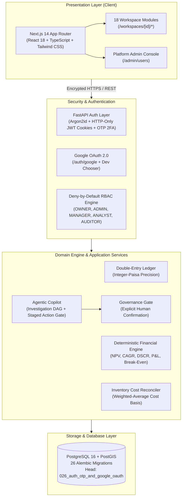

# ArthLens (अर्थLens)

> **Sovereign Financial Operating System & Agentic Decision Intelligence Platform**  
> *Zero Math Hallucination • Integer-Paisa Ledger Precision • Human-in-the-Loop AI Governance • 18 Workspace Modules*

[](https://fastapi.tiangolo.com)
[](https://nextjs.org)
[](https://www.postgresql.org)
[](https://www.typescriptlang.org)
[](https://tailwindcss.com)
[](https://alembic.sqlalchemy.org)
[](https://playwright.dev)
[](https://vitest.dev)

---

## Executive Overview

**ArthLens** is an enterprise-grade sovereign business operating system built for MSMEs, commercial enterprises, and financial stewards. It unifies daily commercial operations—sales invoicing, purchase orders, inventory tracking with weighted-average cost basis reconciliation, double-entry customer/supplier ledgers (*Khata*), and liquid cash treasury—with deterministic financial modeling and agentic AI guidance.

### Core Architectural Differentiators
1. **Zero Math Hallucination**: All calculations (P&L, cash flow, debt service coverage ratio (DSCR), net present value (NPV), annualized CAGR, working capital, and unit economics) are strictly computed by deterministic Python engines and verified ledger tools. The LLM is never permitted to perform raw arithmetic.
2. **Integer-Paisa Ledger Integrity**: All monetary values are modeled in integer paisa ($\text{₹}1.00 = 100\text{ paisa}$) using immutable double-entry bookkeeping principles, eliminating floating-point rounding errors.
3. **Staged AI Governance Gate**: The Agentic Copilot formulates multi-step investigation DAG plans and generates strategic recommendations. Any suggested state-mutating actions (e.g., creating operational tasks, setting goals, or issuing reports) are placed in a staged review gate that requires explicit human owner confirmation before touching the database.
4. **Strict Tenant & Role Isolation**: Every query and transaction is scoped by authenticated multi-tenant business context with deny-by-default role-based access control (RBAC).

---

## Core Architecture & Tech Stack



- **Backend**: FastAPI with async route handlers and synchronous repository wrappers, SQLAlchemy 2.0 ORM, and Alembic (26 sequential migrations ending at `026_auth_otp_and_google_oauth`).
- **Frontend**: Next.js 14 App Router, TypeScript, Tailwind CSS, Framer Motion kinetic surfaces, and Lucide Icons.
- **Database**: PostgreSQL 16 with PostGIS extensions for spatial and multi-tenant ledger persistence.
- **Authentication**: Argon2id password hashing, single-use 6-digit email OTP login verification, Google OAuth 2.0 with cryptographic state validation, and secure HTTP-only SameSite JWT sessions.
- **Quality Assurance**: 164 unit, contract, and integration tests (`pytest`), 22 frontend unit tests (`vitest`), and 8 full-stack browser journeys (`playwright`).

---

## Platform Modules & Features

### Platform Administration (`/admin/users`)
- **System User Directory**: Inspect registered accounts, quota counters, and assigned system roles.
- **Tenant Governance**: Activate, suspend, or terminate accounts with immediate session revocation.
- **Audit Monitoring**: Real-time inspection of auth events, credential resets, and tenant updates.

### 18 Workspace Chapters (`/workspaces/[id]/*`)

| # | Chapter Route | Purpose & Key Capabilities |
|---|---|---|
| **01** | `/` (Overview) | Live executive dashboard with liquid cash reserves, receivables, payables, and health indicators. |
| **02** | `/sales` | Sales order drafting, customer invoice dispatch, payment recording, and credit returns. |
| **03** | `/purchases` | Vendor POs, goods receipt verification, payment releases, and debit purchase returns. |
| **04** | `/inventory` | Product catalog, real-time stock balances, reorder alerts, and historical cost reconciliation. |
| **05** | `/khata` | Traditional double-entry customer & supplier ledgers with debit/credit balance reconciliation. |
| **06** | `/finance` | Financial statements (P&L, Cash Flow, Balance Sheet), liquidity ratios, and break-even analysis. |
| **07** | `/decisions` | Immutable decision versioning, sensitivity evaluations, and causal evidence graphs. |
| **08** | `/scenarios` | 12-month forward financial projections, Monte Carlo simulations, and version comparisons. |
| **09** | `/goals` | Objective tracking with milestone interpolation, action plans, and task assignments. |
| **10** | `/analytics` | Gross margins, working capital cycle, aging analysis, and financial health scoring. |
| **11** | `/agent` | AI Investigation Copilot with deterministic tool execution and human-in-the-loop action staging. |
| **12** | `/customers` | Customer directory, credit terms, lifetime sales, and overdue invoice tracking. |
| **13** | `/suppliers` | Vendor relationship management, procurement history, and outstanding payables. |
| **14** | `/reports` | Exportable PDF and CSV dossier statements, sales registers, and tax ledgers. |
| **15** | `/audit` | Tamper-evident audit trail capturing every actor, IP, timestamp, and state delta. |
| **16** | `/members` | Workspace member invitation, permission delegation, and role matrix configuration. |
| **17** | `/settings` | Workspace parameters, currency configuration, and tenant lifecycle/archival controls. |
| **18** | `/constellation` | Interactive 2D/3D relational graph visualizing connections across customers, vendors, and ledger nodes. |

---

## Quickstart & Deployment Guide

### Option A: One-Command Local Development Launch

ArthLens includes an automated local stack orchestrator that starts the PostgreSQL cluster, verifies schema migrations, seeds demo accounts, and boots both FastAPI and Next.js.

#### On Windows (PowerShell):
```powershell
# 1. Start all services locally (Backend on :8000, Frontend on :3000, DB on :5433)
.\run-local.ps1 -Wait

# 2. To cleanly stop all services and release port bindings:
.\stop-local.ps1
```

#### On Linux / macOS (Bash):
```bash
# 1. Make executable and launch
chmod +x ./start.sh ./stop.sh
./start.sh

# 2. To cleanly stop all services:
./stop.sh
```

#### Default Development Credentials
| Role | Email | Password |
|---|---|---|
| **System Administrator** | `admin@arthlens.org` | `Password123!` |
| **Business Owner** | `entrepreneur@arthlens.org` | `Password123!` |
| **Financial Steward** | `steward@arthlens.org` | `Password123!` |

---

### Option B: Administrative Commands & Seeding

```bash
# Bootstrap the primary system administrator (bypasses UI registration)
python scripts/bootstrap_admin.py --email admin@yourdomain.com --password "SecureAdminPass123!"

# Seed demo businesses, inventories, sales, and khata records
python scripts/seed_demo_accounts.py

# Execute preflight production sanity checks without connecting to live DB
python scripts/deployment_preflight.py
```

---

### Option C: Production Docker Deployment

Deploy the entire stack with isolated container networks, persistent volumes, and health checks:

```bash
# 1. Configure production environment
cp deployment/env.example .env
# Edit .env with your PostgreSQL credentials, JWT secret key, and Gemini API key

# 2. Build and launch containers
docker compose -f deployment/compose.yaml up -d --build

# 3. Verify deployment health with automated smoke checks
python deployment/smoke/run_smoke_checks.py
```

---

## Google OAuth 2.0 Setup Guide

ArthLens supports seamless Google Sign-In and registration. Follow these steps to configure production Google authentication:

1. **Google Cloud Console Setup**:
   - Navigate to [Google Cloud Console](https://console.cloud.google.com/) → **APIs & Services** → **Credentials**.
   - Create an **OAuth 2.0 Client ID** with Application Type set to **Web Application**.
2. **Authorized JavaScript Origins**:
   - For Local Testing: Add `http://localhost:3000` and `http://127.0.0.1:3000`.
   - For Production: Add your public domain (e.g., `https://app.arthlens.org`).
3. **OAuth Consent Screen Configuration**:
   - Go to **OAuth consent screen**.
   - Set Publishing Status to **"In Production"** (or click **Publish App**).  
     *(Note: If left in "Testing" mode, Google will reject sign-ins with `access_denied` for accounts not explicitly whitelisted).*
4. **Environment Variables**:
   - In root `.env` or backend environment:
     ```ini
     GOOGLE_CLIENT_ID=your-google-client-id.apps.googleusercontent.com
     ```
   - In `frontend/.env.local` or frontend environment:
     ```ini
     NEXT_PUBLIC_GOOGLE_CLIENT_ID=your-google-client-id.apps.googleusercontent.com
     ```
5. **Local Development Fallback**:
   - When running on `localhost` without Google Client credentials, ArthLens automatically renders a secure **Local Account Chooser** enabling instantaneous local authentication testing without third-party network dependencies.

---

## Comprehensive Documentation Index

All technical design artifacts, specifications, test matrices, and operational guides are organized within the [`docs/`](file:///c:/arthlens/docs) directory:

### 1. System Architecture & Engineering Specifications
- [**Architecture Document (`docs/ARCHITECTURE.md`)**](file:///c:/arthlens/docs/ARCHITECTURE.md): Complete layered architecture, tenant isolation model, and data flow topologies.
- [**API Specification (`docs/API_SPECIFICATION.md`)**](file:///c:/arthlens/docs/API_SPECIFICATION.md): Comprehensive REST OpenAPI contract covering authentication, workspaces, operations, scenarios, and agent endpoints.
- [**Database Design & Schema (`docs/DATABASE_DESIGN.md`)**](file:///c:/arthlens/docs/DATABASE_DESIGN.md): Entity-relationship definitions, table structures, indexes, and Alembic migration lineage from `001` through `026`.
- [**Domain Model (`docs/DOMAIN_MODEL.md`)**](file:///c:/arthlens/docs/DOMAIN_MODEL.md): Core business aggregates, Money value objects, double-entry ledger invariants, and lifecycle states.
- [**Architectural Decisions Log (`docs/DECISIONS.md`)**](file:///c:/arthlens/docs/DECISIONS.md): Architectural Decision Records (ADRs) explaining key design trade-offs and rationale.
- [**Design Patterns Catalog (`docs/DESIGN_PATTERNS.md`)**](file:///c:/arthlens/docs/DESIGN_PATTERNS.md): Inventory of Gang of Four and enterprise integration patterns utilized across backend and frontend.
- [**Object-Oriented Design (`docs/OOM_DESIGN.md`)**](file:///c:/arthlens/docs/OOM_DESIGN.md): Detailed class diagrams, repository contracts, and behavioral sequence flows.

### 2. Product Requirements & Governance Traceability
- [**Software Requirements Specification (`docs/SRS.md`)**](file:///c:/arthlens/docs/SRS.md): Formal IEEE 830-compliant requirements document detailing functional and non-functional requirements.
- [**Product Requirements Document (`docs/PRODUCT_REQUIREMENTS.md`)**](file:///c:/arthlens/docs/PRODUCT_REQUIREMENTS.md): Feature breakdowns, user stories, acceptance criteria, and operational constraints.
- [**Product Vision & Strategy (`docs/PRODUCT_VISION.md`)**](file:///c:/arthlens/docs/PRODUCT_VISION.md): Market positioning, value proposition, and competitive differentiators for sovereign MSME accounting.
- [**Master Project Plan (`docs/PROJECT_PLAN.md`)**](file:///c:/arthlens/docs/PROJECT_PLAN.md): Implementation roadmap, milestone breakdown, and resource allocation.
- [**Requirements Traceability Matrix (`docs/REQUIREMENTS_TRACEABILITY.md`)**](file:///c:/arthlens/docs/REQUIREMENTS_TRACEABILITY.md): Bidirectional mapping connecting every functional requirement to database schemas, APIs, and tests.
- [**Use Case Traceability Matrix (`docs/USE_CASE_TRACEABILITY.md`)**](file:///c:/arthlens/docs/USE_CASE_TRACEABILITY.md): End-to-end trace from user journeys to automated Playwright specs.

### 3. Quality Assurance, Testing & Operations
- [**Test Strategy & Framework (`docs/TEST_STRATEGY.md`)**](file:///c:/arthlens/docs/TEST_STRATEGY.md): Multi-tiered testing pyramid covering unit, contract, integration, agent-eval, and browser E2E suites.
- [**Test Plan & Verification Results (`docs/TEST_PLAN_AND_RESULTS.md`)**](file:///c:/arthlens/docs/TEST_PLAN_AND_RESULTS.md): Detailed test execution logs, coverage metrics, and pre-deployment pass rates.
- [**Risk Register & Mitigations (`docs/RISK_REGISTER.md`)**](file:///c:/arthlens/docs/RISK_REGISTER.md): Threat modeling, security vulnerability analysis, and mitigation matrices.
- [**Maintenance & Operational Plan (`docs/MAINTENANCE_PLAN.md`)**](file:///c:/arthlens/docs/MAINTENANCE_PLAN.md): Database backup strategies, Alembic migration runbooks, log rotation, and upgrade procedures.
- [**Engineering Handover Guide (`docs/ENGINEERING_HANDOVER.md`)**](file:///c:/arthlens/docs/ENGINEERING_HANDOVER.md): Developer onboarding guide, environment troubleshooting, and repository conventions.

### 4. Guides, Demonstrations & Final Reports
- [**User Guide (`docs/USER_GUIDE.md`)**](file:///c:/arthlens/docs/USER_GUIDE.md): End-user operational manual for business owners, accountants, and team members.
- [**Demonstration Script (`docs/DEMO_GUIDE.md`)**](file:///c:/arthlens/docs/DEMO_GUIDE.md): Step-by-step flagship demonstration script showcasing all 18 chapters and the agent governance loop.
- [**Executive Presentation Deck (`docs/PRESENTATION.md`)**](file:///c:/arthlens/docs/PRESENTATION.md): Slide deck outline and speaking notes detailing the technical innovations of ArthLens.
- [**Final Project Capstone Report (`docs/FINAL_PROJECT_REPORT.md`)**](file:///c:/arthlens/docs/FINAL_PROJECT_REPORT.md): Comprehensive project synthesis documenting architectural achievements, test results, and production readiness.
- [**Engineering Implementation Log (`docs/IMPLEMENTATION_LOG.md`)**](file:///c:/arthlens/docs/IMPLEMENTATION_LOG.md): Chronological commit and development log across all development phases.

---

## Test & Preflight Verification Summary

All automated verification pipelines pass 100% green with zero warnings or transient test failures:

```text
================================ PREFLIGHT SUMMARY ================================
Deployment Preflight:  PASSED (Alembic Head: 026_auth_otp_and_google_oauth)
Backend Test Suite:    164 passed in 18.38s (Unit, Contract, Integration, Agent-Eval)
Frontend TypeScript:   0 compilation errors (npx tsc --noEmit)
Frontend Vitest Suite: 22 passed across 4 test suites (100% green)
Playwright E2E Suite:  8 passed in 32.8s across 4 workers
Production Next Build: 11 static pages & 18 dynamic workspace routes compiled
===================================================================================
```

---

## License

This project is licensed under the Apache 2.0 License. See [LICENSE](LICENSE) for details.
