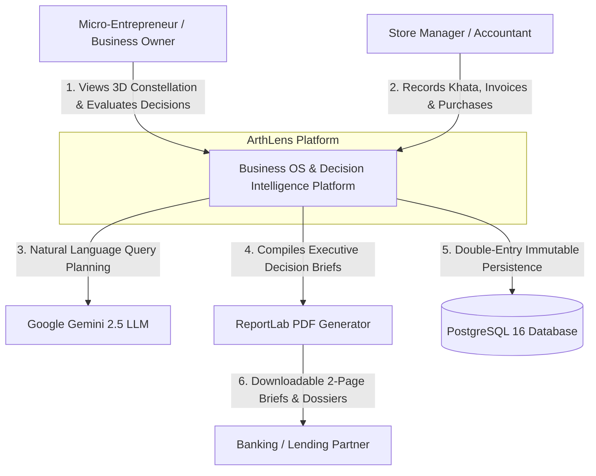
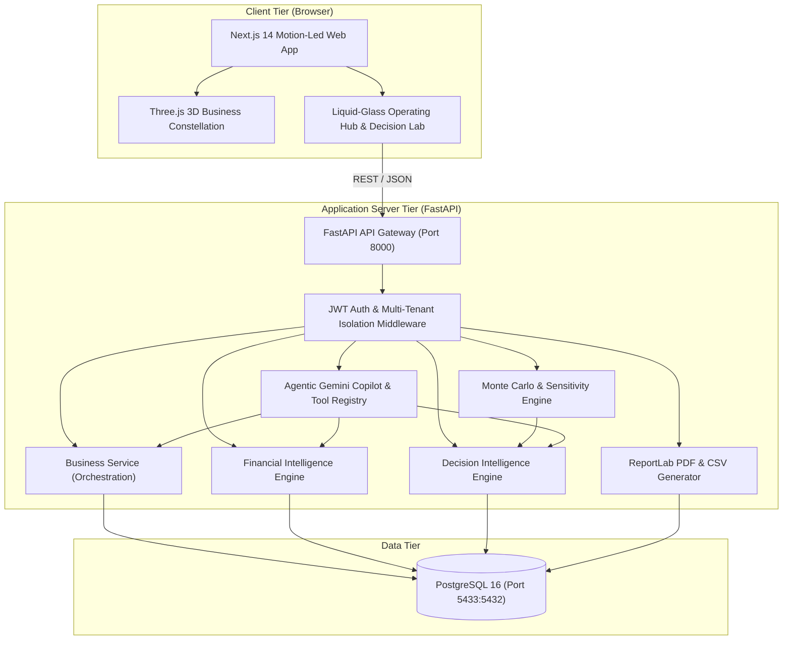
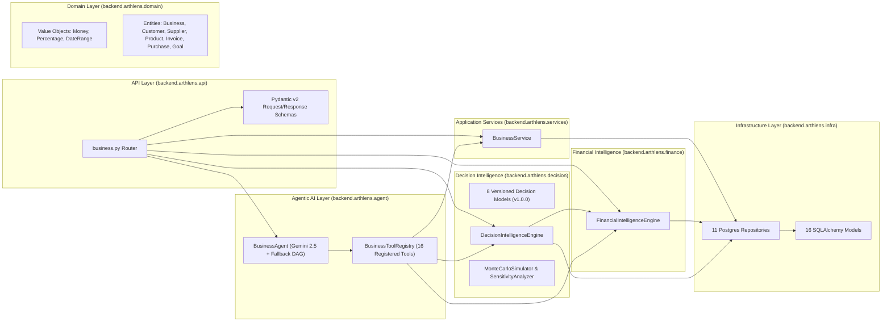
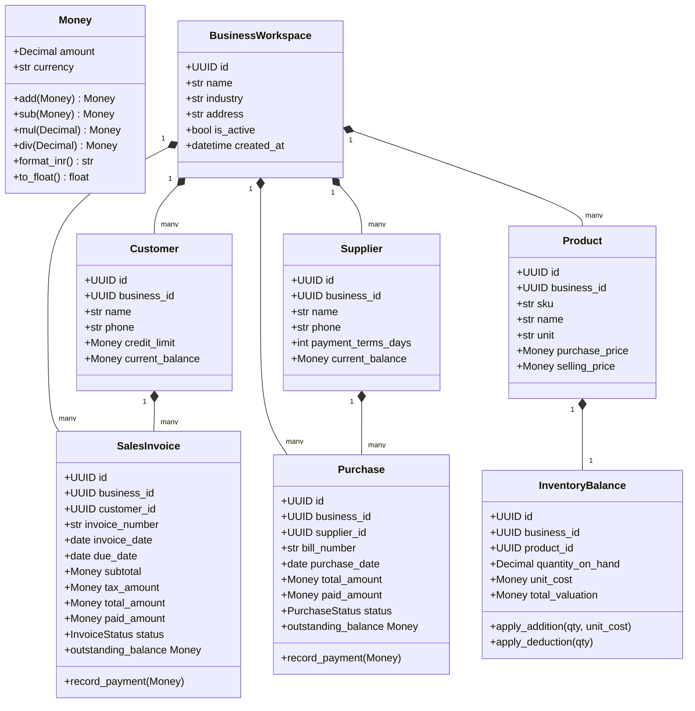
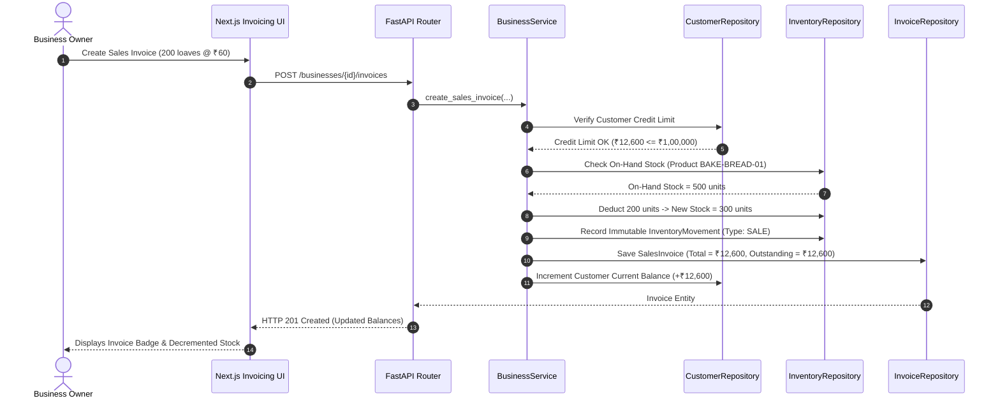
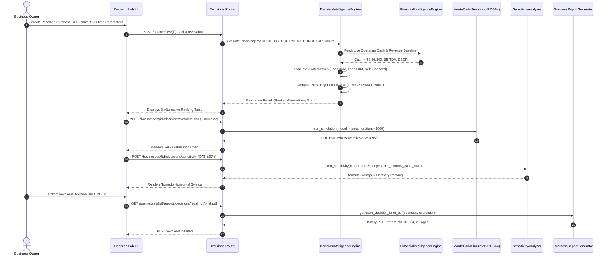
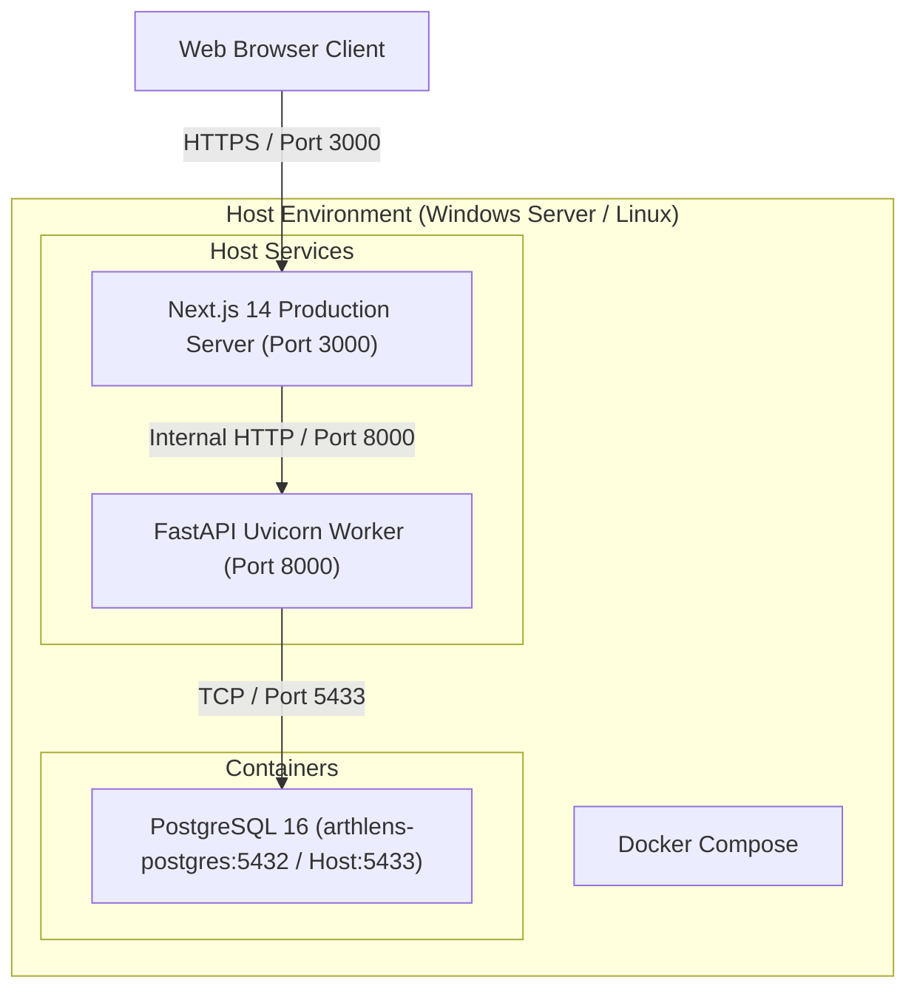

# Architecture Specification & System Design
## ArthLens: Business Operating System & Decision Intelligence Platform

**Architecture Standard:** C4 Model & IEEE 1471  
**Project:** ArthLens  
**Repository:** `C:\arthlens`  
**Core Architectural Thesis:**  
$$\text{ArthLens} = \text{Business Operating System} + \text{Financial Intelligence} + \text{Decision Intelligence} + \text{Agentic AI}$$  
**Version:** 2.0.0-RELEASE  
**Date:** November 2026  

> **Implementation status:** This is inherited design documentation. Treat feature and architecture statements below as design intent until checked against current source; no full product or release verification has been established. See [Engineering Handover](ENGINEERING_HANDOVER.md).

---

## 1. Executive Architectural Summary

ArthLens is an integrated software platform for micro-, small-, and medium-sized enterprises (MSMEs). Unlike fragmented accounting tools, generic chatbots, or static spreadsheet calculators, ArthLens unifies:
1. **The Operational Source of Truth (Business OS):** Captures everyday customer receivables, vendor payables, perpetual stock adjustments with Weighted Average Cost (WAC) valuation, and sales invoicing.
2. **Deterministic Financial Intelligence:** Automatically derives P&L, multi-stream Cash Flow, 90-day Ageing, Solvency ratios, Break-Even analysis, and a 5-pillar composite Health Score.
3. **Decision Intelligence & Simulation Engine:** Evaluates consequential capital and operating decisions across 8 versioned models, executes 1,000-iteration Monte Carlo PCG64 risk simulations, and computes One-At-A-Time (OAT) Tornado sensitivity swings.
4. **Agentic Gemini AI Copilot:** Employs Gemini 2.5 to understand owner inquiries, formulate multi-step investigation DAG plans, call 16 deterministic application tools, surface data gaps, and synthesize actionable guidance without performing synthetic math.
5. **Governance & Reporting:** Generates 2-page executive decision briefs and complete business dossiers in ReportLab PDF format alongside OWASP formula-sanitized CSV exports.

---

## 2. C4 Architecture Model

### Level 1: System Context Diagram



### Level 2: Container Diagram



### Level 3: Component Diagram (Backend Core)



---

## 3. Domain Model & Class Architecture

### Value Objects & Immutability
All monetary values are encapsulated within the immutable `Money` Value Object:
- Backed by Python standard library `Decimal` with exact 2-decimal precision.
- Implements arithmetic operator overloading (`+`, `-`, `*`, `/`).
- Format method: `format_inr()` producing Indian numbering formatting (e.g. `₹8,00,000.00`).
- Floating-point arithmetic on currency is strictly forbidden.



---

## 4. Sequence Diagrams of Key Architectural Workflows

### 4.1 Sales Invoicing with Stock Decrement & Khata Receivable



### 4.2 Flagship ₹8 Lakh Rotary Oven Decision Evaluation & Simulation



### 4.3 Agentic Copilot Investigation DAG Execution

```mermaid
sequenceDiagram
    autonumber
    actor Owner as Business Owner
    participant Chat as Copilot Chat UI
    participant API as Agent Router
    participant Agent as BusinessAgent
    participant LLM as Google Gemini 2.5
    participant Tools as BusinessToolRegistry
    participant Service as Business Operating System

    Owner->>Chat: "Should we buy the 8 lakh rotary oven for the bakery?"
    Chat->>API: POST /businesses/{id}/agent/investigate
    API->>Agent: investigate(business_id, query)
    Agent->>Agent: Sanitize context via CredentialFirewall
    Agent->>LLM: Formulate Multi-Step Investigation DAG
    LLM-->>Agent: DAG Plan: [Step 1: get_cash_position, Step 2: evaluate_decision_model, Step 3: simulate_risk]
    
    loop For each step in DAG
        Agent->>Tools: Execute registered deterministic tool
        Tools->>Service: Query actual database records
        Service-->>Tools: Deterministic mathematical result
        Tools-->>Agent: Validated Pydantic output
    end

    Agent->>LLM: Synthesize explanation using tool evidence only
    LLM-->>Agent: Recommendation: "PROCEED with loan financing; DSCR 2.88x is robust."
    Agent-->>API: Investigation Response (Plan, Evidence, Gaps, Synthesis)
    API-->>Chat: Renders Synthesis, Action Checklist & DAG Nodes
```

---

## 5. Security & Multi-Tenancy Architecture

### 5.1 Credential & Secret Firewall
To ensure strict security and prevent prompt injection or credential exfiltration:
- The `CredentialFirewall` sanitizes all strings before forwarding to external LLM providers.
- API keys, database credentials, JWT secrets, and environment tokens are stripped from prompts.
- Outbound responses are filtered for credential leaks.

### 5.2 Multi-Tenant Workspace Boundary Isolation
- Every database entity (`CustomerModel`, `SalesInvoiceModel`, `ProductModel`, etc.) is tagged with a mandatory `business_id` foreign key.
- Repositories enforce `WHERE business_id = :business_id` on all read, update, and delete queries.
- `BusinessService.verify_access(business_id, user_id)` verifies that the caller has an active `BusinessMembership` with appropriate role permissions before dispatching operations.

### 5.3 OWASP Formula Injection Sanitization
All CSV ledger downloads implement the OWASP standard for formula injection prevention:
- Cells beginning with `=`, `+`, `-`, `@`, `\t`, or `\r` are prefixed with an apostrophe `'`.
- Prohibits malicious CSV payload execution in Microsoft Excel or Google Sheets.

---

## 6. Deployment Architecture



- **Database:** PostgreSQL containerized via Docker on port 5433 host mapping.
- **Backend:** FastAPI running under Uvicorn ASGI with auto-worker scaling.
- **Frontend:** Next.js 14 running production build with standalone SSR support.
- **Auditability:** Zero external SaaS dependencies for core financials or PDF generation; 100% self-contained on premise.
