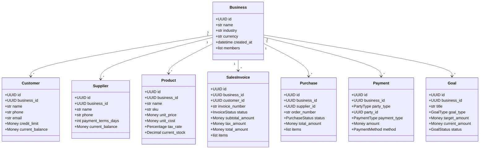

# ArthLens Domain Model Specification

**Product Name:** ArthLens — Business Operating System & Decision Intelligence Platform  
**Architecture:** Pure Domain-Driven Design (DDD) with Zero Framework Coupling  
**Module:** `backend.arthlens.domain.business`

> **Implementation status:** Inherited specification; not independently reconciled with every current class. Use [Engineering Handover](ENGINEERING_HANDOVER.md) for verified findings and open work.

---

## 1. Domain Aggregate Overview

---

## 2. Value Objects

### 2.1 Money
- Immutable monetary representation with `amount: Decimal` and `currency: str`.
- Strict decimal arithmetic with `ROUND_HALF_UP` bankers rounding.
- Disallows arithmetic across incompatible currency codes.

### 2.2 Percentage
- Immutable decimal fraction representation ($0.00 \leq \text{rate} \leq 1.00$).
- Enforces non-negative values and safe multiplier logic.

### 2.3 DateRange
- Encapsulates `start_date: date` and `end_date: date`.
- Enforces invariant: `start_date <= end_date`. Provides duration days and period overlap checks.

---

## 3. Aggregate Entities & Invariants

| Aggregate | Key Invariants |
| :--- | :--- |
| **Business** | Name cannot be empty; default currency is `INR`; creator is assigned `OWNER` role. |
| **Customer** | Current balance tracks receivables; credit limit must be non-negative. |
| **Supplier** | Current balance tracks payables; payment terms must be positive integers. |
| **Product** | SKU unique per business; unit price and cost must be non-negative; current stock tracks movements. |
| **SalesInvoice** | Total amount equals $\sum(\text{item amounts}) + \text{tax} - \text{discount}$; status transitions follow strict lifecycle (`DRAFT -> ISSUED -> PAID / CANCELLED`). |
| **Purchase** | Total amount equals $\sum(\text{purchase items})$; status transitions (`ORDERED -> RECEIVED -> PAID / CANCELLED`). |
| **Payment** | Amount must be positive; party must belong to the same business tenant. |
| **Goal** | Target amount must be positive; progress percentage computed deterministically. |
