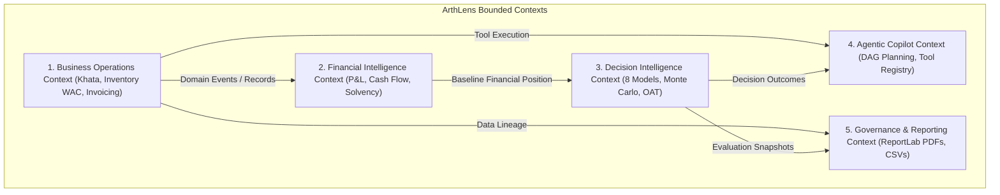

# Object-Oriented Modeling, SOLID Principles & Design Patterns
## ArthLens: Business Operating System & Decision Intelligence Platform

**Standard:** Software Engineering Institute (SEI) & Gang of Four (GoF)  
**Project:** ArthLens  
**Repository:** `C:\arthlens`  
**Version:** 2.0.0-RELEASE  
**Date:** November 2026  

> **Implementation status:** Inherited academic design material; pattern and class claims below have not been checked against all current source. See [Engineering Handover](ENGINEERING_HANDOVER.md).

---

## 1. Executive Summary

ArthLens is built upon strict Object-Oriented Modeling (OOM) and Domain-Driven Design (DDD) principles. Financial arithmetic, perpetual inventory state mutations, and decision modeling require deterministic mathematical rigor that prohibits uncontrolled side effects.

This document formally maps:
1. **SOLID Principles** implemented across backend and frontend layers.
2. **Domain-Driven Design (DDD)** bounded contexts, aggregate roots, entities, and value objects.
3. **23 Software Design Patterns** mapped directly to concrete source files, classes, and methods.

---

## 2. SOLID Principles Implementation

### 2.1 Single Responsibility Principle (SRP)
Every class in ArthLens has one, and only one, reason to change:
- `Money` ([`domain/business.py`](file:///c:/arthlens/backend/arthlens/domain/business.py)): Exclusively encapsulates exact Decimal monetary representation and Indian currency formatting (`format_inr()`). It contains zero persistence or database logic.
- `FinancialIntelligenceEngine` ([`finance/intelligence.py`](file:///c:/arthlens/backend/arthlens/finance/intelligence.py)): Exclusively responsible for calculating financial statements (P&L, Cash Flow, Solvency, Ageing, Break-even, Health score) from business records. It does not handle HTTP requests or PDF rendering.
- `BusinessReportGenerator` ([`reporting/business_reports.py`](file:///c:/arthlens/backend/arthlens/reporting/business_reports.py)): Exclusively responsible for converting domain entities and decision evaluations into ReportLab Flowable PDFs and OWASP-sanitized CSVs.
- `BusinessToolRegistry` ([`agent/business_tools.py`](file:///c:/arthlens/backend/arthlens/agent/business_tools.py)): Exclusively maintains the registry of 16 deterministic application tools and validates Pydantic parameter schemas.

### 2.2 Open/Closed Principle (OCP)
The system is open for extension but closed for modification:
- `BaseDecisionModel` ([`decision/models.py`](file:///c:/arthlens/backend/arthlens/decision/models.py)): New capital decision models (e.g. franchising, solar installation) can be introduced by subclassing `BaseDecisionModel` and registering them with `DecisionModelRegistry` without altering existing model code or the evaluation engine.
- `BusinessTool` ([`agent/business_tools.py`](file:///c:/arthlens/backend/arthlens/agent/business_tools.py)): Adding new operational tools to the Agentic Gemini Copilot requires only defining a new `BusinessTool` subclass with Pydantic arguments; the DAG planner and execution loop remain untouched.

### 2.3 Liskov Substitution Principle (LSP)
Subclasses are completely substitutable for their base types without altering system correctness:
- Any implementation of `BaseDecisionModel` (`MachinePurchaseDecisionModel`, `ProductAdditionDecisionModel`, `SupplierSwitchDecisionModel`, etc.) adheres to the identical signature:
  `evaluate(business_baseline: Dict[str, Any], inputs: Dict[str, Any], constraints: Dict[str, Any]) -> DecisionEvaluationResult`.
  The `DecisionIntelligenceEngine` executes any model polymorphically.

### 2.4 Interface Segregation Principle (ISP)
Clients should not be forced to depend on interfaces they do not use:
- Rather than a monolithic `DataRepository`, ArthLens segregates persistence into 11 fine-grained repositories:
  - `PostgresCustomerRepository`: customer Khata and credit limits.
  - `PostgresSupplierRepository`: vendor payables and terms.
  - `PostgresProductRepository`: product catalog and pricing.
  - `PostgresInventoryRepository`: stock on-hand and movement audit trail.
  - `PostgresSalesInvoiceRepository`: sales invoices and billing items.
  - `PostgresPurchaseRepository`: procurement bills.
  - `PostgresPaymentRepository`: cash and bank ledger transactions.
  - `PostgresGoalRepository`: operational milestones and recalculations.

### 2.5 Dependency Inversion Principle (DIP)
High-level policy modules do not depend on low-level detail modules; both depend on abstractions:
- `BusinessService` ([`services/business_service.py`](file:///c:/arthlens/backend/arthlens/services/business_service.py)) depends on repository abstractions injected via its constructor:
  `def __init__(self, business_repo, customer_repo, supplier_repo, inventory_repo, invoice_repo, ...)`
- In production, PostgreSQL repositories are injected. In testing, memory or mock repositories can be substituted with zero modifications to service logic.
- FastAPI dependency injection (`Depends(get_business_service)`) dynamically resolves dependencies at runtime.

---

## 3. Domain-Driven Design (DDD) Mapping

### 3.1 Aggregates & Aggregate Roots
1. **`BusinessWorkspace` Aggregate:**
   - Root: `BusinessWorkspace`
   - Entities: `BusinessMembership`
   - Invariant: A business must have at least one active `OWNER`. All business transactions are strictly scoped to the workspace UUID.
2. **`SalesInvoice` Aggregate:**
   - Root: `SalesInvoice`
   - Entities: `SalesInvoiceItem`
   - Value Objects: `Money` (subtotal, tax, discount, total, paid, outstanding)
   - Invariant: Total amount must equal $\text{Subtotal} + \text{Tax} - \text{Discount}$. Stock on hand must satisfy line item quantities before invoice issuance. Outstanding balance equals $\text{Total} - \text{Paid}$.
3. **`InventoryBalance` Aggregate:**
   - Root: `InventoryBalance`
   - Entities: `InventoryMovement`
   - Value Objects: `Money` (unit cost, total valuation)
   - Invariant: Stock additions automatically update Weighted Average Cost:
     $$\text{WAC} = \frac{\text{Previous Value} + (\text{Added Qty} \times \text{Cost})}{\text{Previous Qty} + \text{Added Qty}}$$
     Stock deductions cannot drive quantity below zero unless explicitly overridden by physical audit adjustments.

---

## 4. 23 Software Design Patterns Mapping

The following table documents the 23 design patterns implemented throughout ArthLens:

| # | Pattern Name | Classification | Primary Concrete File & Class | Architectural Purpose & Implementation Detail |
|---|---|---|---|---|
| **1** | **Value Object** | Domain / Creational | `domain/business.py` `class Money` | Immutable monetary representation backed by Python `Decimal`. Overloads operators and formats INR strings (`format_inr()`). |
| **2** | **Entity** | Domain / Structural | `domain/business.py` `class Customer`, `class Product` | Domain objects with unique lifecycle identities (`UUID`) and mutable operational state. |
| **3** | **Aggregate Root** | Domain / Structural | `domain/business.py` `class SalesInvoice` | Manages consistency boundaries, line items, and stock invariants upon creation and payment. |
| **4** | **Repository Pattern** | Architectural / Data | `infra/business_repositories.py` `class PostgresSalesInvoiceRepository` | Mediates between domain entity objects and PostgreSQL SQLAlchemy relational tables. |
| **5** | **Unit of Work** | Architectural / Data | `infra/business_repositories.py` `with self.session_factory() as session:` | Manages database transactions, ensuring atomic commits and rollbacks across parent and child models. |
| **6** | **Strategy Pattern** | Behavioral | `decision/models.py` `class BaseDecisionModel` | Encapsulates 8 distinct financial decision strategies (`MachinePurchase`, `NewProduct`, `SupplierSwitch`, etc.) behind a common interface. |
| **7** | **Factory Pattern** | Creational | `decision/models.py` `class DecisionModelRegistry.get_model()` | Dynamically instantiates the requested decision model class based on string model identifier. |
| **8** | **Command Pattern** | Behavioral | `agent/business_tools.py` `class BusinessTool.execute()` | Encapsulates operational tool requests into executable command objects with validated argument parameters. |
| **9** | **Template Method** | Behavioral | `decision/models.py` `BaseDecisionModel.evaluate_with_constraints()` | Defines algorithm skeleton: input validation $\to$ baseline retrieval $\to$ model calculation $\to$ constraint checks $\to$ alternative ranking. |
| **10** | **Observer Pattern** | Behavioral | `domain/business.py` `InventoryMovement` logging | Logs immutable audit records whenever `InventoryBalance.apply_addition()` or `apply_deduction()` changes stock. |
| **11** | **Decorator Pattern** | Structural | `api/business.py` `@router.post()`, `@dataclass` | Augments endpoint functions with routing, JSON schema validation, and serializable dataclass attributes. |
| **12** | **Registry Pattern** | Creational / Behavioral | `agent/business_tools.py` `class BusinessToolRegistry` | Centralized registry holding 16 deterministic application tools with Pydantic schemas. |
| **13** | **Builder Pattern** | Creational | `reporting/business_reports.py` `class BusinessReportGenerator` | Step-by-step assembly of complex multi-page PDF documents using ReportLab Flowables (Paragraph, Table, Spacer). |
| **14** | **Adapter Pattern** | Structural | `api/business.py` `serialize_invoice()`, `serialize_purchase()` | Adapts internal domain entities into external REST API JSON response dictionaries. |
| **15** | **Façade Pattern** | Structural | `services/business_service.py` `class BusinessService` | High-level unified interface hiding the complexity of 11 repositories, inventory movements, and ledger postings. |
| **16** | **Composite Pattern** | Structural | `decision/models.py` `class DecisionGraph` | Represents hierarchical parameter dependency networks consisting of individual Nodes and directed Edges. |
| **17** | **Chain of Responsibility** | Behavioral | `agent/business_agent.py` `BusinessAgent.investigate()` | Request passes through: `CredentialFirewall` $\to$ Query Classifier $\to$ Tool Execution DAG $\to$ Plain-Language Synthesizer. |
| **18** | **State Pattern** | Behavioral | `domain/business.py` `class InvoiceStatus` | Manages invoice lifecycle transitions (`DRAFT` $\to$ `ISSUED` $\to$ `PARTIALLY_PAID` $\to$ `PAID` $\to$ `CANCELLED`). |
| **19** | **Proxy Pattern** | Structural | `api/dependencies.py` `Depends(get_current_user)` | Intercepts HTTP requests to verify JWT signature, expiration, and user permissions before executing router logic. |
| **20** | **Memento / Snapshot** | Behavioral | `infra/models.py` `class DecisionEvaluationModel` | Stores serialized snapshots of decision inputs, calculations, and rankings in PostgreSQL for retrospective audit. |
| **21** | **Specification Pattern** | Behavioral | `services/business_service.py` `verify_access()` & credit limit checks | Encapsulates business rule predicate checks for RBAC and customer credit exposure. |
| **22** | **Null Object Pattern** | Behavioral | `domain/business.py` `Money.zero()` | Provides default zero-money representations to prevent `NoneType` null-pointer exceptions in arithmetic expressions. |
| **23** | **Flyweight Pattern** | Structural | `infra/config.py` SQLAlchemy Connection Pool | Reuses pre-allocated database connections across concurrent requests, minimizing connection overhead. |

---

## 5. Architectural Quality Attributes & Non-Functional Verification

### 5.1 Deterministic Arithmetic
- Zero IEEE 754 floating-point rounding errors: All currency computations utilize Python's `Decimal` with `ROUND_HALF_UP` quantization.
- LLMs are prohibited from executing in-context math: All figures surfaced in Copilot chats or PDF briefs originate from executed Python tools.

### 5.2 Testability
- Complete decoupling of domain models from persistence allows fast, isolated unit tests without database overhead.
- Repository pattern enables lightweight SQLite or PostgreSQL test harness switching.
