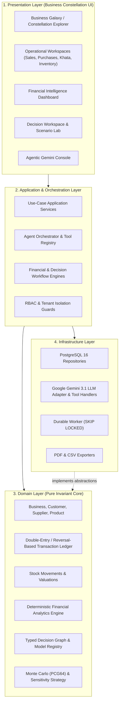

# ArthLens Product Vision & Governing Specification

**Product Name:** ArthLens  
**Product Category:** Business Operating System & Decision Intelligence Platform  
**Governing Specification:** ArthLens Final Product Vision, Architecture & Implementation Handbook  
**Evaluation Date:** 19 November 2026  

---

## 1. Executive Summary

ArthLens is an intelligent business management and decision-support platform engineered to help business owners operate multiple enterprises, maintain operational source of truth, understand their true financial and operational position, evaluate consequential business decisions, simulate possible outcomes, and take decisive, evidence-backed actions.

### The Product Equation
$$\text{ArthLens} = \text{Business Operating System} + \text{Financial Intelligence} + \text{Decision Intelligence} + \text{Agentic AI}$$

ArthLens is emphatically **not**:
- A generic CRUD accounting dashboard.
- A basic loan or break-even financial calculator.
- A thin chatbot wrapper around an LLM.
- A geography-first or district-pilot demonstration.

Its core competitive value arises from unifying everyday operational reality (invoices, stock, khata, payments) with deterministic financial analytics, explainable multi-alternative decision graphs, and autonomous AI-assisted investigations.

---

## 2. Central Product Philosophy

1. **Business Records are the Source of Truth**: All financial statements, health indicators, and decision evaluations originate from actual recorded business transactions.
2. **Financial Calculations are Deterministic**: 100% of arithmetic, discounting, debt schedules, working capital cycles, and ratios are calculated by auditable, decimal-safe Python engines—never guessed or estimated by an LLM.
3. **Decision Models are Explicit, Reusable, and Versioned**: Decisions are structured as typed, acyclic evaluation graphs containing hard constraints, financial dependencies, alternative generation, and sensitivity analysis.
4. **AI Investigates and Explains; It Does Not Replace Logic**: Google Gemini serves as an autonomous investigator—interpreting user objectives, planning tool DAGs, querying business records, identifying missing facts, and explaining outcomes.
5. **Missing Information is Surfaced, Not Invented**: When data is incomplete, ArthLens raises an explicit gap (`INSUFFICIENT_INFORMATION`) and asks clarifying follow-up questions rather than manufacturing assumptions.
6. **Contradictory Information is Flagged**: Conflicting records or assumptions immediately trigger `CONTRADICTORY_INFORMATION` alerts.
7. **Every Consequential Decision is Explainable**: Outcomes trace their complete lineage back to supporting records, model versions, and explicit user assumptions.
8. **User Control Over Consequential Actions**: The AI proposes tasks and explains recommendations; consequential actions (issuing invoices, committing payments, taking loans) remain under explicit user control.
9. **Zero Dead UI & Complete Feature Integration**: Every button, form, and table connects to an active backend service. Loading, empty, success, and error states are universally handled.

---

## 3. Product Architecture & 12 Core Modules

### Module Catalogue
1. **Module 1: Multi-Business Workspace** (Registration, multi-business switcher, profiles, roles, archival).
2. **Module 2: Customers, Suppliers & Khata** (Customer/supplier parties, credit/debit records, partial payments, ledgers, ageing, reconciliation).
3. **Module 3: Sales & Invoicing** (Invoices, line items, taxes, payment status, credit sales, returns, printable views).
4. **Module 4: Purchases & Payables** (Supplier bills, line items, partial payments, dues tracking, purchase returns).
5. **Module 5: Inventory Management** (Product catalogue, units, stock additions/deductions, adjustments, low-stock alerts, valuation).
6. **Module 6: Income & Expenses** (Categorised direct/indirect expenses, income receipts, recurring items).
7. **Module 7: Financial Intelligence** (Revenue, COGS, gross/net profit, cash flow, working capital, ageing, break-even, ratios, health scores).
8. **Module 8: Decision Intelligence** (Typed decision graphs, constraints, 8 versioned models, alternative generation, ranking).
9. **Module 9: Scenario Laboratory** (Snapshots, assumptions, base/optimistic/pessimistic cases, Monte Carlo simulation, sensitivity tornado).
10. **Module 10: Goals & Planning** (Revenue/profit goals, debt reduction targets, variance analysis, plan-to-actual tracking).
11. **Module 11: Agentic Gemini AI** (Objective extraction, DAG planning, tool registry, gap detection, follow-ups, deterministic execution, explanation).
12. **Module 12: Reports & Governance** (Dossiers, PDF/CSV export, immutable audit trail, model lineage).
