# ArthLens Transformation Master Project Plan

**Governing Specification:** ArthLens Final Product Vision, Architecture & Implementation Handbook  
**Repository Working Directory:** `C:\arthlens`  
**Remote Git Policy:** GitHub Frozen after commit `fe11829`; 100% local execution  
**Target Completion:** Complete 100 Use Cases across 12 Modules  

---

## 1. Phase Breakdown & Execution Sequence

```mermaid
flowchart LR
    P0["Phase 0: Preservation & Audit"] --> P1["Phase 1: Domain & Infrastructure"]
    P1 --> P2["Phase 2: Business Operations"]
    P2 --> P3["Phase 3: Financial Intelligence"]
    P3 --> P4["Phase 4: Decision & Simulation Engine"]
    P4 --> P5["Phase 5: Agentic Gemini AI"]
    P5 --> P6["Phase 6: Constellation UI & Motion"]
    P6 --> P7["Phase 7: Final Integration & Release"]
```

---

### Phase 0: Repository Preservation and Transformation Audit (Current)
- [x] Inspect repository state, working tree, and remotes.
- [x] Check for exposed credentials and ensure `.env` exclusion.
- [x] Create baseline checkpoint commit `fe11829: chore: preserve original ArthLens before product transformation`.
- [x] Push baseline commit to GitHub.
- [x] **Freeze GitHub** (All subsequent development strictly local in `C:\arthlens`).
- [x] Run baseline build and test suites (545 unit tests passed, 42 Vitest passed, 10/10 pages compiled).
- [x] Inspect existing modules and classify as KEEP, IMPROVE, ADAPT, REBUILD, REMOVE.
- [x] Author `docs/PRODUCT_VISION.md`, `docs/REQUIREMENTS_TRACEABILITY.md`, `docs/PROJECT_PLAN.md`.

---

### Phase 1: Domain & Infrastructure
**Objective:** Establish core domain entities, value objects, database models, repository contracts, and multi-tenant business isolation.
- **Domain Entities & Value Objects**:
  - `User`, `Business`, `BusinessMembership` (OWNER, MANAGER, ACCOUNTANT, VIEWER).
  - Value objects: `Money` (decimal-safe currency arithmetic), `Percentage`, `Quantity`, `DateRange`, `BusinessId`.
- **Database Schema & Migrations**:
  - Alembic migration `014_business_operating_system.py`:
    - `businesses`, `business_memberships`
    - `customers`, `suppliers`
    - `products`, `inventory_balances`, `inventory_movements`
    - `sales_invoices`, `sales_invoice_items`, `purchases`, `purchase_items`, `payments`
    - `income_records`, `expense_records`
    - `goals`
    - `decision_evaluations`, `scenarios`
  - Strict foreign keys, tenant isolation checks, and decimal constraints.
- **Repositories & Application Services**:
  - `PostgresBusinessRepository`, `PostgresCustomerRepository`, `PostgresSupplierRepository`, `PostgresProductRepository`.
  - Dependency-injected service boundaries.
- **Testing**:
  - Value object invariant tests (`Money`, rounding, negative checks).
  - Multi-business tenant isolation tests (cross-tenant access rejected).

---

### Phase 2: Business Operations
**Objective:** Implement the operational source of truth across Khata, Invoicing, Purchases, Inventory, and Income/Expenses.
- **Khata & Parties (Module 2)**:
  - Customer & supplier party creation, credit and debit entries, partial payments.
  - Party-wise running balance reconciliation with immutable audit history.
- **Sales & Invoicing (Module 3)**:
  - Invoice creation with line items, tax, discounts, and payment terms.
  - Atomic sale completion: creates invoice, posts ledger entry, decrements inventory, updates customer receivable.
  - Sales returns and credit notes.
- **Purchases & Payables (Module 4)**:
  - Supplier purchase recording, line items, supplier payable ledger creation, inventory increment.
  - Purchase returns.
- **Inventory Management (Module 5)**:
  - Opening stock, additions, deductions, damage/loss adjustments with documented reasons.
  - Low-stock alerts and Weighted Average Cost (WAC) valuation.
- **Income & Expenses (Module 6)**:
  - Direct & indirect expense recording with custom categories.
  - Income receipts and payment method tracking.
- **Testing**:
  - Atomic transaction integration tests (invoice -> ledger -> stock -> receivable).
  - Partial payment allocation tests.
  - Zero and negative stock protection tests.

---

### Phase 3: Financial Intelligence Engine
**Objective:** Calculate authoritative financial analytics directly from recorded operational transactions.
- **Core Financial Metrics**:
  - Revenue, COGS, Gross Profit, Operating Expenses (OpEx), Net Profit (EBITDA / Net Margin).
  - Operating Cash Flow, Receivables, Payables, Net Working Capital.
  - Receivable and Payable Ageing buckets (0-30, 31-60, 61-90, 90+ days).
  - Break-Even Analysis: fixed costs, unit variable cost, unit price, break-even units, break-even revenue, margin of safety.
  - Financial Health Ratios: Current Ratio, Quick Ratio, Debt Service Coverage Ratio (DSCR), Cash Conversion Cycle (DIO + DSO - DPO).
- **Period Comparisons & Snapshots**:
  - Month-over-month, quarter-over-quarter, and financial year comparative summaries.
  - Immutable `FinancialSnapshot` capturing timestamp, model version, and exact input transaction set.
- **Goals & Planning (Module 10)**:
  - Revenue, profit, debt-reduction, and reserve targets.
  - Variance analysis: plan versus actuals with deviation tracking.
- **Testing**:
  - Decimal arithmetic precision tests.
  - Financial snapshot reproducibility tests.

---

### Phase 4: Decision Intelligence & Simulation Engine
**Objective:** Implement the typed decision graph, 8 reusable models, scenario laboratory, and Monte Carlo risk engine.
- **Typed Decision Graph**:
  - Node types: `QUESTION`, `CONDITION`, `CALCULATION`, `EVIDENCE`, `ALTERNATIVE`, `TERMINAL_OUTCOME`.
  - Edge types with condition predicates and dependencies.
- **8 Versioned Decision Models**:
  1. Business Financial Health Audit (`model:fin-health:v1`).
  2. Equipment Purchase Affordability (`model:equipment-afford:v1`).
  3. Loan vs Lease vs Own-Capital Financing (`model:financing-compare:v1`).
  4. Business Expansion Feasibility (`model:expansion-feasibility:v1`).
  5. Break-Even and Price Sensitivity (`model:pricing-breakeven:v1`).
  6. Cash-Flow Pressure & Runway (`model:cashflow-pressure:v1`).
  7. Inventory Replenishment & Safety Stock (`model:inventory-reorder:v1`).
  8. Customer Credit Risk & Exposure (`model:credit-exposure:v1`).
- **Decision Outcomes**:
  - `FEASIBLE`, `CONDITIONALLY_FEASIBLE`, `NOT_FEASIBLE`, `INSUFFICIENT_INFORMATION`, `CONTRADICTORY_INFORMATION`.
  - Hard constraints evaluated before alternative ranking.
- **Scenario Laboratory & Monte Carlo (Module 9)**:
  - Scenario versioning: base case, optimistic case, pessimistic case.
  - Sensitivity analysis: one-at-a-time (OAT) parameter sweeps generating tornado diagrams.
  - Reproducible Monte Carlo simulation using NumPy `PCG64` with explicit seeds, distributions (triangular, normal, uniform), and iteration counts.
- **Testing**:
  - Hard constraint rejection tests.
  - Replay invariance: identical seed and inputs produce identical numerical distributions.

---

### Phase 5: Agentic Gemini AI Layer & Reports
**Objective:** Integrate Google Gemini for natural-language understanding, investigation planning, follow-up questioning, and explanation without compromising deterministic integrity.
- **Gemini Architecture**:
  - Provider abstraction: `GeminiProvider` using backend API key with offline deterministic fallback.
  - 16-tool registry:
    - `get_business_profile`, `get_financial_snapshot`, `get_customer_dues`, `get_supplier_dues`
    - `get_sales_summary`, `get_expense_summary`, `get_inventory_status`, `get_transaction_history`
    - `evaluate_decision_model`, `calculate_break_even`, `calculate_loan`, `run_scenario`
    - `run_sensitivity_analysis`, `compare_alternatives`, `generate_decision_report`, `create_business_task`
  - Gap detector: identifies missing facts and generates clarifying questions.
  - Bounded agent loop with session persistence and tool-call traces.
- **Reports & Governance (Module 12)**:
  - Multi-format Decision Dossiers (PDF with ReportLab, CSV with injection escaping).
  - Immutable audit trail and evidence provenance linking.
- **Testing**:
  - Mock and live tool execution contract tests.
  - Deterministic fallback tests (complete offline operation without LLM).

---

### Phase 6: Premium Motion-Led UI & Business Constellation
**Objective:** Build an original visual identity featuring the Business Constellation / Galaxy concept and operational workspaces.
- **Design System & Motion Framework**:
  - Visual identity: Deep space nebula / obsidian glass with luminous cosmic accents (gold, emerald, cyan).
  - Motion stack: GSAP for kinetic typography & scroll storytelling, Framer Motion for component micro-interactions, Three.js for 3D interactive galaxy navigation.
  - Full keyboard accessibility and `prefers-reduced-motion` compliance.
- **Application Surfaces**:
  - Business Galaxy Explorer (visual constellation of businesses and connected clusters).
  - Operational Workspaces: Khata & Parties, Invoices & Sales, Purchases, Inventory, Income & Expenses.
  - Financial Intelligence Dashboard with interactive charts.
  - Decision Workspace: Interactive decision graph, alternatives ranking, constraint checklist.
  - Scenario Laboratory: Sliders, tornado sensitivity charts, Monte Carlo probability histograms.
  - Agent Console: Interactive chat with thought steps, tool traces, and gap inquiries.
  - Reports & Audit History.

---

### Phase 7: Complete Integration, Verification & Final Academic Deliverables
**Objective:** End-to-end integration, execution of the continuous ₹8 lakh machine purchase journey, and preparation of all academic documentation.
- **Continuous Demonstration Journey**:
  - Complete 20-step journey from Section 19 of the handbook.
- **Academic & Software Engineering Deliverables (Section 13 & 20)**:
  - Final `README.md`.
  - `docs/SRS.md`, `docs/ARCHITECTURE.md`, `docs/DOMAIN_MODEL.md`, `docs/DATABASE_DESIGN.md`.
  - UML Diagrams (Use-case, Class, Sequence, Activity, State, Component, ER).
  - SOLID mapping & Design pattern catalog.
  - Requirements Traceability Matrix (`docs/REQUIREMENTS_TRACEABILITY.md`).
  - Test plan & execution evidence (`docs/TEST_RESULTS.md`).
  - PowerPoint presentation structure & Demonstration guide.
  - Final local verification.
